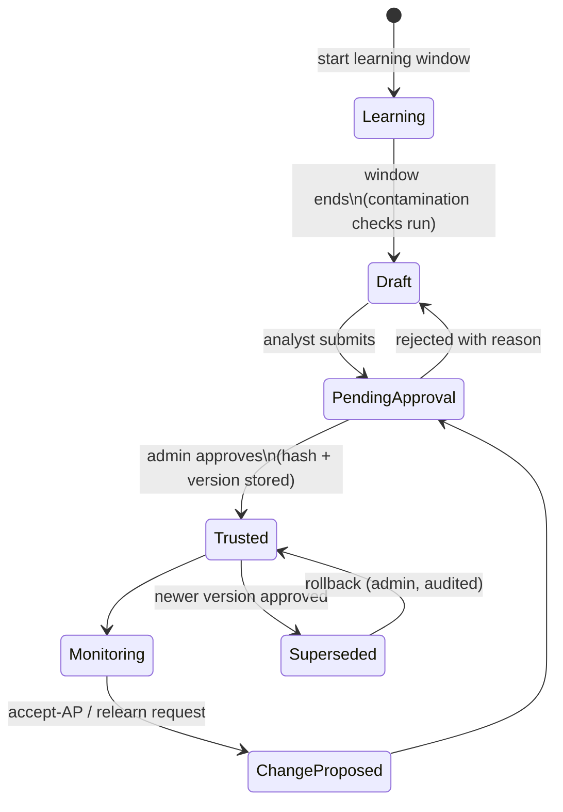
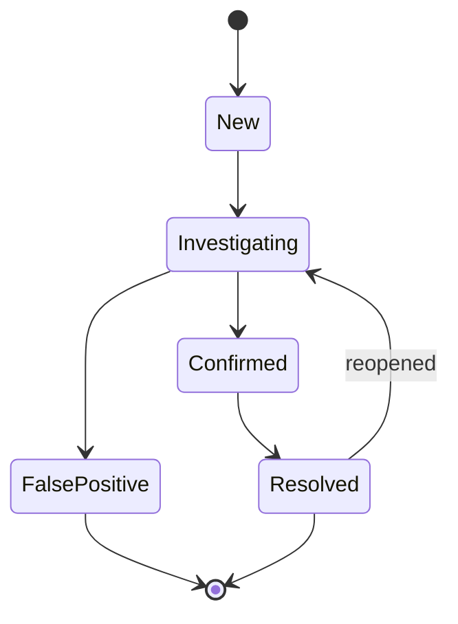
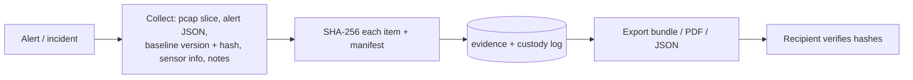
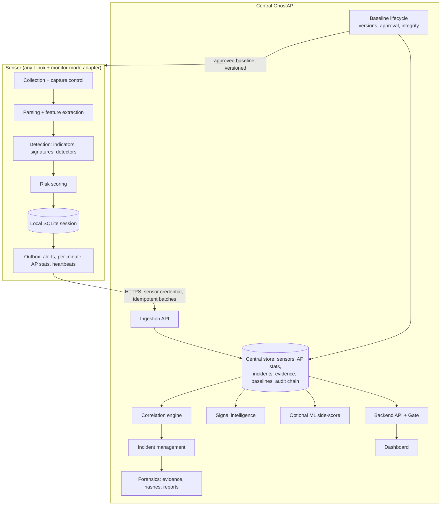

# GhostAP 2.0 — Repository Audit and Engineering Proposal

> **Status (kept up to date).** Approved 14 Nov 2026.
> - **Phase 0 (Stabilise): done** (commit `3f2482d`). After it: simpler dashboard (`810207a`), Live radar
>   page (`23b0ef7`), radar error/empty states and UI fixes (`5250ac7`).
> - **Next:** Phase 1 (real lab captures on the sensor, `docs/KALI_SETUP.md` §7-8), then Phase 2 (Integrity).
> - **Answers to section 21:** one sensor only, a TP-Link Archer T2U Plus (RTL8821AU, 2.4/5 GHz, **no 6 GHz**;
>   see `docs/HARDWARE.md`), so no multi-sensor lab tests and no 6 GHz / Wi-Fi 7 validation on own hardware.
>   PDF report at the very end, not now. No deadline. The public AWID3 dataset may be used (ML phase).
>   Team size / two-person approval and CI status: not answered yet.
>
> The audit text below describes the repository as it was at `c5337d7`, before Phase 0.

Audit of commit `c5337d7` (main, in sync with origin), 14 Nov 2026. Read-only: no project file,
configuration, dependency, schema or Git state was changed.

**Evidence labels:** **[V]** verified (source read, executed, or measured here) · **[R]** recommendation ·
**[A]** assumption · **[U]** unknown, needs investigation.

---

## 1. Executive summary

GhostAP is no longer a prototype. The package is ~10,000 lines of Python in 43 modules, ~4,700 lines of
dashboard JavaScript and **217 passing tests** **[V]**. It already has much of what the 2.0 brief lists, at
least in a first form:
- a sensor-to-central reporting path with trilateration;
- RSN/AKM/PMF parsing;
- saved baselines with audit;
- derived incidents;
- evidence pcaps and checksummed session bundles;
- offline learned weights and an anomaly model;
- systemd and Docker files;
- extensive docs.

**The honest gaps are depth, robustness and validation, not breadth:**

1. **No real-world validation.** Every detection number comes from 11 synthetic, author-designed scenarios **[V]**.
   This is the largest credibility gap, and ML cannot responsibly be added before it is closed.
2. **Three verified security defects:**
   - cross-site request forgery against body-less POSTs when running locally without accounts;
   - configuration (including webhook URLs) readable by the viewer role;
   - trusted file paths inside imported session bundles.
3. **One verified reliability defect:** the detector keeps every observation in memory unless retention is
   turned on. Measured at 950 bytes per observation, that is roughly 1.7 GB/hour for 50 APs at 10
   beacons/s.
4. **Thin parts:**
   - Multi-sensor support is a summary push with no identity binding, buffering, history or offline alerts.
   - Baselines have no versions, integrity or approval.
   - Incidents are computed on the fly, not stored.
   - ML exists only inside the offline evaluation.
   - Evidence has no hash chain.
   - The Docker image has never been built.

**Recommendation [R]:**
- **Phase 0:** fix the defects and bound memory.
- **Then, in parallel:**
  - collect labelled real captures (the old "Phase 2");
  - harden the baseline lifecycle and persist incidents;
  - make sensors robust: store-and-forward over the existing HTTPS API, with no new broker.
- **Only after enough verified labels exist:** add an optional ML side-score.

**Minimum viable 2.0** = Phase 0 + baseline lifecycle + persisted incidents with evidence hashing + robust
sensors + validated real-capture results.

---

## 2. Current repository architecture

### 2.1 Entry points [V]

| Entry point | Purpose |
|---|---|
| `python -m ghostap.web` (`web.py:main`, line ~548) | dashboard + replay / live pipeline (main product) |
| `python -m ghostap.collector` | headless pcap / live collection to a DB |
| `python -m ghostap.risk`, `ghostap.indicators` | CLI scoring / indicator dumps |
| `python evaluate.py` / `ghostap.evaluate` | labelled evaluation (+ `--extended`) |
| `ghostap.{users,apikeys,sessions,monitored,signatures,vendors,kismet}` | admin CLIs |
| `tools/*.py`, `tools/*.sh` | data generation, labelling, demo, benchmarks, screenshots, number sync, monitor mode, service install |

### 2.2 Actual data flow [V]

```mermaid
flowchart LR
  subgraph Capture
    A[Wi-Fi iface monitor mode<br/>or pcap file] --> B["collector.collect_live / Pipeline._ingest_replay<br/>Scapy sniff / PcapReader"]
    H[hopper.ChannelHopper<br/>iw set channel] -.controls.-> A
    CC[capture.CaptureControl<br/>pause / hop] -.-> B
  end
  B --> P["parser.parse_frame / parse_event<br/>reject bad FCS, truncated, malformed"]
  P -->|observation + layout| S[(session.db<br/>observations, layouts, events)]
  S -->|observations_after| IS["pipeline.IncrementalScorer.step (every 2 s)"]
  IS --> AN["indicators.Analyzer<br/>Baseline (first N min or saved monitored.json)<br/>8 indicators + 3 signatures"]
  AN --> RE["risk.RiskEngine<br/>score, 3-step smoothing, levels, alerts"]
  IS --> DD[DuplicateSSID / Deauth / Flood detectors]
  RE --> S2[(session.db: alerts, risk_timeline, ap_latest, ap_profiles)]
  DD --> S2
  S2 --> API["Flask app (web.py + web_*.py)<br/>Gate: keys / viewer / accounts / token"]
  ADM[(admin.db: audit, mutes, users, logins,<br/>api_keys, notify_*, sensors)] <--> API
  API --> UI[Dashboard app.js + views/*.js<br/>polls /api/summary every 2 s]
  S2 --> NT[notify.NotifierThread] --> OUT[webhooks / e-mail / syslog / jsonl]
  S2 --> RP[sensors.Reporter] -->|HTTPS POST| CEN[central /api/sensors/report]
```



### 2.3 Modules and responsibilities [V]

| Layer | Modules (lines) | Notes |
|---|---|---|
| Collection | `collector.py` (233), `hopper.py` (139), `capture.py` (~70) | Scapy `sniff` in 1 s chunks; hopper thread calls `iw` |
| Parsing | `parser.py` (324), `beacons.py`, `vendors.py` | beacon fingerprint = SHA-1 (truncated) of element layout; RSN parsed from raw bytes |
| Storage | `storage.py` (610), `sessions.py` (278) | SQLite WAL per session + `admin.db`; migrations are ad hoc column adds in `Store._migrate` (line 223), with no schema version |
| Detection | `indicators.py` (905), `signatures.py` (192), `risk.py` (547) | Analyzer keeps all observations in memory and evaluates per (SSID, BSSID) per 10 s step |
| Orchestration | `pipeline.py` (327) | threads: ingest, scoring loop (`_score_loop`, line 300); hopper |
| Config | `config.py` (290), `monitored.py` | defaults → `config.yaml` → `data/settings.yaml`, all validated |
| Web | `web.py` (733; `create_app` spans lines 109-546), 12 `web_*.py` modules, 88 routes | `ctx` `SimpleNamespace` shared by all modules |
| Auth | `web_auth.py` (339), `auth.py` (427), `apikeys.py`, `tls.py`, `users.py` | scrypt, server-side sessions, TOTP, roles, viewer links |
| Integrations | `notify.py` (359), `sensors.py` (250), `ai.py` (186), `web_integrations.py` | all off by default |
| Evaluation | `evaluate.py` (551), `evaluate_extended.py`, `stats.py`, `kismet.py`, `whatif.py` | numpy only |
| Front end | `static/app.js` (1,530), `ux.js`, `present.js`, `i18n.js`, `views/*.js` (12 pages) | no build step; strict CSP |

### 2.4 Threads and background work [V]

| Thread | Purpose |
|---|---|
| Pipeline ingest | replay or live capture |
| Scoring loop | every `rescore_seconds` (2 s) |
| ChannelHopper | live, with `--hop` |
| NotifierThread | when notifications are enabled; polls every 5 s |
| sensors.Reporter | on a sensor; every 10 s |
| What-if preparation | on demand |
| Evaluation runner | on demand |
| waitress | 8 workers (cheroot when serving HTTPS) |

Shared state is passed through `ctx` attributes (for example `ctx.pipeline` is swapped by the demo
button, `web_demo.py`).

### 2.5 Sessions, history, errors, logging [V]

- **Sessions:** each run has its own folder `data/sessions/<id>/` (`session.db`, `meta.json`,
  `capture.pcap`, `labels.json`).
- **Cross-session state** lives in `data/admin.db`, `data/monitored.json` and `data/settings.yaml`.
- **Logging:** rotating file `data/logs/ghostap.log` (1 MB × 5). The console shows warnings only.
- **Error handling:** 19 broad `except Exception` sites, mostly deliberate around untrusted radio input or
  network I/O; each logs the error or shows it in the UI.

---

## 3. Complete existing feature inventory

**Status classes:**
- **IMPL:** the code path is traced, wired to UI/API, and covered by tests.
- **PARTIAL:** works, with gaps listed in the Limitations column.
- **EXPERIMENTAL:** works in tests, but depends on hardware or data never tested here.
- **MISSING** and **DOC-ONLY**.

"Real-world validated" is **No for every detection feature** **[V]**.

### 3.1 Detection

| Feature | Files / functions | Status | Tests | Limitations / evidence |
|---|---|---|---|---|
| Duplicate-SSID baseline detector | `risk.py` `DuplicateSSIDDetector` (300) | IMPL | test_risk, test_evaluate | the comparison baseline, not a defence |
| BSSID / OUI analysis | `indicators.new_bssid_oui` (318), `vendors.py` | IMPL | test_indicators | OUI is spoofable (s02 synthetic) |
| Beacon fingerprint | `parser.beacon_layout` (79), `indicators.ie_fingerprint` (542) | IMPL | test_parser, test_detection | 4 synthetic beacon profiles only; real collision rate unknown **[U]** |
| TSF analysis | `indicators.tsf_anomaly` (401) | IMPL | test_indicators | reboots → benign-cause hints |
| Beacon interval | `beacon_interval_mismatch` (516) + beacon-rate check | IMPL | test_detection | |
| Channel deviation | `channel_deviation` (340) | IMPL | test_indicators | weight 1.0 (noisy) |
| RSSI analysis | `rssi_jump` (367), `_signal_tracks` (452) | IMPL | test_indicators, test_detection | single-sensor RSSI |
| Security downgrade | `security_downgrade` (296), `_detail_downgrade` (272), `parser.parse_rsn` (135) | **PARTIAL** | test_detection | group cipher not parsed (skipped at `parser.py:146`); OWE ranked equal to SAE (`akm_class`, line 124); no RSNX (element 244) |
| Cloned BSSID / two transmitters | `bssid_conflict` (474) | IMPL | test_detection | |
| Clock skew | `clock_skew_ppm` (250) | EXPERIMENTAL | test_detection | real driver timestamp jitter unknown |
| KARMA / MANA | `signatures.karma_value` (126), Analyzer `names_of` | IMPL (synthetic) | test_detection | |
| Look-alike SSID | `signatures.lookalike_target` (73) | IMPL | test_detection | homoglyph table is small |
| Attack-tool fingerprints | `signatures.load_library` / `match_tool`, `ghostap/data/bandits.json` | **PARTIAL** | test_detection | library holds only 2 synthetic examples, disabled by default |
| Deauth / disassoc flood | `parser.parse_event` (296), `risk.DeauthDetector` (348) | EXPERIMENTAL | test_detection | never run on real radio; stores no client MACs |
| Beacon flood | `risk.FloodDetector` (402) | IMPL (synthetic) | test_detection | |
| Hidden-network matching | `Analyzer._decloak` (668) | IMPL | test_detection | |
| Weighted scoring + smoothing + levels | `risk.risk_score` (97), `RiskEngine.run` (231) | IMPL | test_risk, test_live_and_incremental | the incremental run equals a one-shot run **[V]** |
| Baseline learning | `indicators.Baseline` (154), `SSIDBaseline` (103) | IMPL | test_indicators | a twin present during learning is learned as normal |
| Saved baselines | `monitored.py` `learn` / `upsert` / `add_ap`; `web_monitored.py` | **PARTIAL** | test_monitored_api, test_foundations | no versions, integrity or approval |
| Per-network sensitivity | `RiskEngine.thresholds_for` (202) | IMPL | test_detection | |
| Wi-Fi 6 / 6E awareness | `parser.band_of` / `channel_from_freq`, HE elements, hopper 6E | EXPERIMENTAL | test_detection | 6 GHz never captured here |
| Wi-Fi 7 / MLO | names only, in `beacons.py` lines 28-29 | **MISSING** | — | EHT and Multi-Link elements are not parsed |

### 3.2 Platform

| Feature | Files | Status | Tests | Limitations |
|---|---|---|---|---|
| PCAP replay | `pipeline._ingest_replay` (235) | IMPL | many | |
| Live capture + hopping + recording | `collect_live` (68), `hopper.py` | EXPERIMENTAL | fake-sniff tests | needs Kali + adapter; not run here |
| Capture control (pause / hop) | `capture.py`, `web_sensors.py:40` | EXPERIMENTAL | test_sensors | simulated frames only |
| Sessions, bundles | `sessions.py` (`export_bundle` 163, `import_bundle` 197) | IMPL | test_lab, test_foundations | **security defect S3** |
| Alerts, triage, bulk, history, mutes | `web.py:423`, `web_admin.py` | IMPL | test_web, test_triage_ui_api | no "resolved" state |
| Incidents | `risk.build_incidents` (449) | **PARTIAL** | test_triage_ui_api | derived per request, not persisted, no lifecycle |
| Evidence pcap | `web_ap.evidence_pcap` (143) | IMPL | test_ap_detail | no hash; **S3** applies |
| Session report | `web_lab.py:88` (HTML) | IMPL | test_lab | no PDF / JSON export; does not separate facts from inference |
| Auth (keys, accounts, 2FA, viewer links, HTTPS) | `web_auth.Gate` (38), `auth.py`, `tls.py` | IMPL | test_auth, test_integrations | **S1, S2** |
| Notifications, metrics, OpenAPI | `notify.py`, `web_integrations.py` | IMPL (local fakes) | test_integrations | real services not contacted |
| Multi-sensor + location | `sensors.py`, `web_sensors.py` | **PARTIAL** | test_sensors | see section 7, Feature 1 |
| What-if, evaluation page, labelling | `whatif.py`, `web_lab.py`, `web_tools.py` | IMPL | test_whatif_notes, test_lab | what-if re-prepares on every live data version |
| ML experiments | `stats.learn_weights`, `stats.Anomaly`, `evaluate_extended.py` | EXPERIMENTAL | test_stats_kismet | offline only, synthetic data |
| Kismet comparison | `kismet.py` | EXPERIMENTAL | test_stats_kismet | schema-based; Kismet never run |
| AI explainer | `ai.py`, `web_ai.py` | EXPERIMENTAL | test_ai (fake client) | needs an API key; off by default |
| systemd | `deploy/ghostap.service`, `tools/install_service.sh` | EXPERIMENTAL | test_deploy (static) | never installed |
| Docker | `Dockerfile`, `docker-compose.yml` | **DOC-ONLY in practice** | test_deploy (static) | **image never built** |
| Settings page, audit log, retention, health | `web_settings.py`, `storage.audit`, `pipeline._retention` (92) | IMPL | test_deploy, test_foundations | retention is off by default (see P1) |

**Broken features:** none found. All 217 tests pass, and the demo script runs **[V]**. The defects below
are security and robustness defects, not functional breakage.

---

## 4. Broken, incomplete and missing

| ID | Issue | Evidence | Severity for 2.0 |
|---|---|---|---|
| P1 | Analyzer holds every observation (950 B each measured); retention is 0 (off) by default | `measure.py` in the audit sandbox; `config.py` retention default | **High** (long live runs) |
| P2 | RSN group cipher and group-management cipher not parsed; OWE treated like SAE | `parser.py:144-157`, `parser.py:124` | Medium |
| P3 | Incidents not persisted; no "resolved" state | `risk.py:449`, `storage.py:510` | Medium |
| P4 | Baselines unversioned; any analyst learns or accepts without approval | `web_monitored.py:93-165` | Medium (poisoning) |
| P5 | Sensors: no buffering, no history, no identity binding, no offline alert | `sensors.py:95-186` | Medium |
| P6 | No database schema version or migration framework | `storage.py:223` | Medium (2.0 adds many tables) |
| P7 | Docker image never built; CI does not build it | `.github/workflows/tests.yml` | Medium |
| P8 | Wi-Fi 7 / MLO, RSNX, 6 GHz rules missing | grep | Low–Medium |
| P9 | What-if rebuilds its recording on each live data version (2.85 s at 101 APs, measured) | `web_tools.py:20` | Low |
| P10 | `/api/timeline` loads every row on each data change, so cost grows with session length | `web.py:478` | Low–Medium |
| P11 | Latest CI result unknown (`gh` not installed here) | — | **[U]** |

---

## 5. Security audit findings

| # | Severity | Location | Finding | Status | Fix [R] |
|---|---|---|---|---|---|
| S1 | **Medium** | `web_integrations.py:130` (keys revoke), `web_admin.py:144`, `web_tools.py:110`, `web_sensors.py:109`, `web_auth.py:334`, `web_integrations.py:53` | Local mode (no accounts) authorises every localhost request. The Host-header check stops DNS rebinding but **not cross-site form posts**, which still address `127.0.0.1`. Body-less POSTs act without JSON. | **Verified:** a cross-site form POST revoked an API key (HTTP 200) | Global `before_request`: for unsafe methods require `Sec-Fetch-Site` ∈ {same-origin, none} or an `Origin` that matches the host, and require a JSON content type on every POST (send `{}` for body-less actions) |
| S2 | **Medium** | `web_monitored.py:225` `settings_effective`; also `/api/notifications`, `/api/audit` | Viewer role (and read API keys) can read the full config, including plain webhook URLs with tokens, SMTP user, and login IP addresses in the audit log | **Verified:** viewer saw the test token | Admin-only; redact URL paths, query strings and usernames; audit visible to analyst+ |
| S3 | **Medium** (needs an admin to import a crafted bundle) | `sessions.py:197` keeps the bundle's `meta.source`; `web_lab.py:48` `_source_pcap`; `web_ap.py:192` | A replay session's `source` path is trusted. Labels export (`web_lab.py:246`) **copies** it into `data/lab/`; evidence export parses it. | **Verified:** imported meta source honoured (the copy itself was traced by reading, not executed) | Strip `source` on import; only accept pcaps inside the session folder or `data/`, using `realpath` checks |
| S4 | Low | `auth.py:245` `_locked` | Lockout keyed on user name lets anyone lock a known account for 10 min | By design, unverified impact | Key on (user, IP) with progressive delay; keep an IP-wide cap |
| S5 | Low | `web.py:688` | Start-up token printed to stdout, and so to the systemd journal | Verified (code) | Print once to the TTY only; file mode 600 option |
| S6 | Low | `web.py:53` | CSP `style-src 'unsafe-inline'` (inline style attributes used) | Verified | Move inline styles to classes; drop `unsafe-inline` |
| S7 | Low | `sensors.py:139`, `web_sensors.py:69` | Any write API key can report as any sensor name (no identity binding) | Verified (code) | Per-sensor credentials bound to the sensor name (Feature 1) |
| S8 | Low | `storage.py:560` | Audit log can be edited by anyone with file access; no tamper evidence | Verified | Hash-chained audit (Feature 7) |
| S9 | Info | `web.py` after_request | No HSTS, even with a trusted certificate | Verified | Add HSTS when `--tls-cert` is used |
| S10 | Info | `requirements.txt` | Version ranges only, no hashes or lock file | Verified | Lock file with hashes for releases |
| S11 | Info | Scapy parsing of untrusted pcaps / radio | Parser hardened (rejects damaged frames; fuzz test), but relies on Scapy dissectors | Verified (tests) | Keep fuzzing; add pcap size limits for imports |

**Positive controls verified:**
- parametrised SQL everywhere (formatting only splices constants and placeholders);
- `esc()` on everything from the air;
- strict CSP with no inline scripts;
- JSON-only POSTs for every endpoint with a body;
- 64 KB request limit and Host-header check;
- scrypt passwords; hashed API keys and session IDs; TOTP replay protection;
- zip-slip-safe bundle import; `subprocess` calls only with argument lists (no shell).

**Dependency audit:** `pip-audit` on `requirements.txt` and `requirements-ai.txt`: no known
vulnerabilities, 14 Nov 2026 **[V]**.

---

## 6. Code quality and performance findings

### 6.1 Quality [V]

- `create_app` is a 437-line closure (`web.py:109-546`). Modules share an implicit `ctx` service locator
  that other modules extend (`ctx.ap_facts_for`, `ctx.summary_dict` calls a view function).
  Refactor into a small `AppContext` class with typed methods **[R]**.
- Duplication:
  - `baseline_end` exists twice (`web.py:301`, `web_ap.py:187`);
  - indicator labels exist three times (`app.js` `IND`, `web_lab.LABELS` (line 20), notify reason text).
- `app.js` is 1,530 lines; the newer pages are already split into `views/` modules.
- Migrations: no `user_version`; 2.0's new tables need ordered, tested migrations.
- Thread safety:
  - `evaluate.make_charts` (line 287) uses pyplot in a background thread, while reports use the
    object-oriented API: a theoretical race;
  - `ctx.pipeline` is swapped without a lock (low risk, but untidy).
- Type hints are good in core modules and partial in the web modules.
- Front-end logic has no unit tests (parse checks + manual browser checks only).
- Lint clean (ruff, including bandit-style S rules) **[V]**.

### 6.2 Performance

| Measurement | Value | Source |
|---|---|---|
| `parse_frame` throughput (excluding Scapy decode) | ~1,900 frames/s | **[V]** measured today, test capture, M-series Mac |
| SQLite insert (`Store.add`) | ~250,000 rows/s | **[V]** today |
| Memory per observation held by the Analyzer | ~950 B | **[V]** today (tracemalloc) |
| 101 APs × 10 min synthetic site: scoring | 2.8 s | **[V]** today (`bench_large_site.py`) |
| Same site: `/api/summary`, `/api/timeline`, `/api/ap/related` | 1.2 ms, 5.6 ms (53 KB), 16.8 ms | **[V]** today |
| 402 APs × 20 min: scoring | 58 s (≈0.54 s per 10 s step) | `docs/PERFORMANCE.md` (13 Nov) |
| Real busy-channel frame rate vs. throughput on a Raspberry Pi | unknown | **[U]** |
| Memory at 50 APs × 10 beacons/s | ≈1.7 GB/hour | **[A]** extrapolated (950 B × 500/s) |

Channel-hopping overhead, CPU use on a real sensor, and long-run stability were **not measured**: they need
live hardware **[U]**.

---

## 7. Selected feature gap analysis

### Feature 1 — Distributed multi-sensor monitoring

**Existing [V]:**
- Sensors push a summary every 10 s over HTTPS with a write API key (`sensors.Reporter`, line 95):
  health, APs heard in the last minute with mean RSSI, open alerts.
- The central server keeps only the **latest** snapshot per sensor (`sensor_aps` is replaced on each report).
- Sensors page with positions; trilateration (`sensors.locate`, line 188); configurable CA.

| Capability | Reuse | Improve | New |
|---|---|---|---|
| Registration / auth | API keys, Gate | | per-sensor enrolment token → sensor credential bound to the name (+ optional mTLS) |
| Secure transport | HTTPS + CA pinning (`report_ca`) | require HTTPS for reports when exposed | |
| Health + disconnect alerts | `fleet()` "online" flag | | heartbeat table; "sensor silent > N s" alert through the notifier |
| Independent channels | per-sensor `--hop` | | central-managed channel plan (sensor pulls config) |
| Config management | settings overlay | | `GET /api/sensors/{id}/config` (versioned; sensor polls) |
| Event ingestion | report endpoint | idempotent batch IDs | store-and-forward outbox on the sensor (SQLite); alerts + per-minute AP stats |
| Network-wide correlation | `merged()` | persist history | central correlation rules (same BSSID, different fingerprint per sensor; twin seen only by some sensors) |
| RSSI comparison | per-sensor `rssi` | | per-minute RSSI history per sensor |
| Metrics | `/metrics` | | per-sensor frame rate, lag, buffer depth |
| Offline operation | each sensor is a full GhostAP **[V]** | | bounded outbox + later sync; deduplication by report ID |

**Transport comparison [R]:**

| Option | Reliability | Security | Complexity | Scale | Verdict |
|---|---|---|---|---|---|
| **HTTPS REST + outbox** | good with idempotent retries | reuses TLS, keys, Gate | low (no new service) | tens of sensors | **Recommended** |
| MQTT | QoS 1/2, retained messages | broker ACLs and TLS to manage | new broker + `paho-mqtt` | hundreds+ | later, if many sensors |
| WebSockets | needs reconnect logic | same TLS | waitress lacks WebSocket support → new server stack | medium | not needed (polling is enough) |
| Message queue (RabbitMQ, Redis) | strong | another service to secure | high | high | overkill |

**Storage:**
- Keep SQLite (WAL) for the central server up to roughly 10 sensors **[A]**.
- Put new central tables behind a thin repository layer so PostgreSQL can be added if sensor count or
  retention requires it **[R]**. Do not migrate pre-emptively.

**Hardware:** any Linux laptop or SBC with a monitor-mode adapter can be a sensor. The sensor role does not
need the dashboard UI (`--headless` mode **[R]**).

### Feature 2 — WPA3, PMF, Wi-Fi 6E, Wi-Fi 7

**Existing [V]:**
- AKMs parsed: PSK, SAE, SAE-EXT, FT-*, OWE, 802.1X, Suite-B.
- PMF read from RSN capabilities.
- Downgrade details: enterprise→PSK, WPA3→transition, PMF off.
- 6 GHz frequency → channel mapping; HE elements in the fingerprint; 6E hopping by frequency.

**Gaps [R]:**
- Parse the group cipher and group-management cipher (BIP); flag a group downgrade (e.g. TKIP group).
- Rank OWE separately (unauthenticated encryption, not SAE).
- Pair the OWE-transition element with its hidden OWE BSS.
- RSNX (element 244): SAE hash-to-element (H2E) and SAE-PK.
- 6 GHz policy check: on 6 GHz, an open/PSK-only network or PMF not required is anomalous (Wi-Fi 6E rule).
- Reduced Neighbor Report (element 201) for co-located 6 GHz APs.
- Wi-Fi 7: EHT capabilities / operation (extension IDs 108 / 106) and the **Basic Multi-Link element**
  (extension ID 107, MLD MAC address). Group MLO-affiliated BSSIDs, so one AP's 2.4/5/6 GHz links are not
  flagged as "new radios".
- All of these are parsed from raw bytes (as RSN already is); no Scapy upgrade needed **[A]**.

**What passive monitoring can and cannot tell [R]:**

| Inferable from beacons / probe responses | Needs specific hardware | Not inferable passively |
|---|---|---|
| AKM / cipher suites offered, PMF flags, transition mode advertised, RSNX bits, EHT / ML elements present, MLD address | 6 GHz reception (Wi-Fi 6E chipset + driver with monitor mode); 320 MHz / EHT reception | whether clients actually negotiate SAE or PMF; handshake security; credentials; MLO link use by clients |

**Compatibility matrix:** everything below needs lab testing **[U]**.

| Band / capability | Typical requirement | Status here |
|---|---|---|
| 2.4 / 5 GHz beacons | most monitor-capable USB adapters (Atheros AR9271, RT3070/RT5572, MT7612U) **[A]** | software path tested with synthetic frames |
| 6 GHz | Wi-Fi 6E chipset with a Linux monitor-mode driver (e.g. MediaTek MT7921AU, `mt7921u`) **[A]**; regulatory domain must allow 6 GHz | untested |
| Wi-Fi 7 / MLO | MT7925-class adapters; driver maturity uncertain **[U]** | untested |

### Feature 3 — Anti-baseline poisoning

**Existing [V]:**
- Saved baselines (`monitored.json`): wizard, accept AP, remove AP, inbox decisions, allow-list.
- Every change audited; live hot-reload.
- `label_capture.py` warns if an attack overlaps the learning period.

**Gaps:**
- No versions, snapshots or rollback.
- No integrity check.
- No approval step.
- No contamination checks during learning.
- Observed and trusted profiles are not separated: without a saved baseline, each session learns its own.

**Lifecycle [R]:**



**Contamination checks during learning [R]:** run the signature checks (KARMA, look-alike, tool), BSSID
conflict, freshly-booted APs, and mixed open + protected networks under one SSID. Any hit marks the draft
"needs review"; it cannot be approved silently.

**Integrity [R]:**
- SHA-256 of the canonical JSON, stored per version.
- An HMAC with a server key kept outside `data/` detects edits made outside GhostAP.
- Verify on load; refuse an unknown-hash baseline, with a clear error.

**False-positive control:** controlled updates via "accept change" proposals (existing UI), plus the
approval step.

### Feature 4 — Signal intelligence and heatmaps

**Existing [V]:**
- Per-AP RSSI series in 10 s buckets (`/api/ap/series`).
- `rssi_jump`; two-transmitter detection via signal tracks.
- Multi-sensor latest RSSI; trilateration with an uncertainty radius; SVG map.

**New [R]:**
- Persistent per-minute RSSI statistics (mean, standard deviation, count) per (sensor, BSSID).
- Fluctuation analysis (MAD-based) and an "appearance tracker" (first seen per sensor).
- Coverage view: which sensors hear which channels.
- Floor-plan image (admin upload: PNG/JPEG ≤ 5 MB, re-encoded server-side with Pillow, served from `data/`).
- Plotly heatmaps (already bundled).
- Leaflet is **not** recommended: indoor maps need no geographic tiles, and a CDN breaks the CSP.
- Channel utilisation only where APs advertise the BSS Load element (11): passive and honest.

**Limitations to document:**
- RSSI-based location is rough: multipath, walls, bodies, antenna gain and transmit power.
- Report a confidence region, never a point.
- Calibrate P0 and the path-loss exponent per site.

### Feature 5 — Advanced incident investigation

**Existing [V]:**
- Derived incidents (`build_incidents`: alerts grouped within 300 s), with story steps.
- Per-alert triage with history in the audit log; notes (timeline annotations); mutes; related APs;
  evidence pcap; HTML report.

**New [R]:**
- A persistent `incidents` table (status lifecycle below, severity, assignee, summary).
- Links to alerts (cross-session by `(session_id, alert_id)`) and to evidence.
- Incident notes; recommended defensive actions (a static playbook per indicator, e.g. "check the AP
  inventory", "notify users to forget the network", never offensive actions).
- Search (status, date, SSID, BSSID); export (JSON / CSV / PDF).
- Merge and split.
- Reuse the alert triage states; add **Resolved**.



### Feature 6 — ML-assisted detection

**Existing [V]:**
- Offline logistic-regression weights fitted on a tune split (`stats.learn_weights`).
- A Mahalanobis anomaly score (`stats.Anomaly`).
- Both run only in `evaluate --extended`, on synthetic data; numpy only.

**Reality check [R]:**
- The labelled data available today is 11 synthetic captures with 6 twins.
- Supervised models (Random Forest, XGBoost) would overfit and prove nothing.

**Proposal [R]:**
1. Dataset first: real lab captures labelled on the Label page; a target of **≥ 30 twin instances across
   ≥ 4 twin platforms, and ≥ 50 hours of benign captures** **[A]** (to be agreed).
2. A **separate ML side-score**, shown next to the rule score, never replacing it; off by default.
3. **Isolation Forest** (scikit-learn) as the first runtime model: unsupervised, trained only on approved
   baselines / benign sessions, explained by per-feature contributions.
4. Random Forest **only** once the label target is met; capture-grouped cross-validation; report FP/FN and
   calibration (Brier score).
5. Model registry: version, training-data hashes, feature list, metrics; refuse inference if the feature
   schema mismatches.
6. Skip XGBoost: it adds a heavy dependency without benefit at this data size.

**Public datasets:** AWID3 (University of the Aegean) is a candidate that includes evil-twin classes.
Licence, frame types and relevance to beacon-level features **must be verified [U]**; it is mostly
client-traffic oriented.

### Feature 7 — Forensic evidence and reports

**Existing [V]:**
- Evidence pcap (beacons only; privacy-preserving).
- Session bundle with a SHA-256 manifest.
- Printable HTML report.
- Audit log; triage history.

**New [R]:**
- `evidence` records with a SHA-256 taken at creation, plus custody events (created, viewed, exported,
  by whom).
- Hash-chained audit log (each row stores the previous row's hash).
- UTC ISO-8601 timestamps that distinguish capture time from wall time.
- Incident evidence bundle (pcap slice, alert JSON, baseline version and hash, sensor info, notes) with a
  manifest.
- JSON / CSV export.
- PDF via the existing headless-Chrome tool, or `reportlab` (pure Python) **[R: reportlab, so servers do
  not need a browser]**.
- Reports with separate **Observed facts** and **Inferences** sections, carrying rule and ML scores.
- Retention policy per evidence class.



### Feature 8 — Deployment, packaging, reliability

**Existing [V]:**
- systemd unit (least privilege) + install script.
- Dockerfile / compose (unbuilt).
- Health-check module; rotating logs.
- CI on Python 3.11-3.13 with ruff, pip-audit, tests, evaluation and the number check.
- Validated config; settings overlay.

**Gaps [R]:**
- Build and smoke-test the image in CI.
- Lock file with hashes (pip-tools).
- Schema version + migrations + migration tests.
- `ghostap backup` / `restore` (admin.db, monitored.json, settings, sessions).
- Optional JSON logs.
- `MemoryMax` / `CPUQuota` in the unit.
- Explicit SIGTERM handling test.
- Ubuntu + Raspberry Pi OS (arm64) install docs and a CI arm64 job (QEMU) or a manual checklist.
- Production config check at start-up: warn when exposed without HTTPS / accounts.

### Feature 9 — Documentation overhaul

**Existing [V]:** README, CLAUDE.md, KALI_SETUP, API, DEPLOY, PERFORMANCE, ACCESSIBILITY, ROADMAP, REPORT,
DEMO.

**Add [R]:**
- ARCHITECTURE.md (diagrams 1-7 from this document);
- INSTALL.md (Kali / Ubuntu / Raspberry Pi / Docker);
- CONFIGURATION.md (generated from `config.py` defaults);
- DEVELOPER.md, TESTING.md, DETECTION.md (indicators, scoring, baseline);
- SENSORS.md, HARDWARE.md (tested-adapter matrix: only what was actually tested);
- TROUBLESHOOTING.md, SECURITY.md (threat model + reporting), CONTRIBUTING.md, CHANGELOG.md.

Every claim must be backed by a test or labelled "untested".

---

## 8. Proposed GhostAP 2.0 architecture



**Principles [R]:**
- A single machine stays a valid deployment: central + sensor in one process (today's behaviour).
- Keep the explainable rule engine as the authority; ML is advisory.
- Change the minimum: grow existing modules, and introduce subpackages only where code grows past one file.

**Security boundaries:**
- radio ↔ parser (untrusted input);
- sensor ↔ central (mutual authentication);
- browser ↔ API (Gate, CSRF, CSP);
- operator ↔ baseline (approval);
- export ↔ recipient (hashes).

**External dependencies:**
- **None required for P0–P3.**
- Optional: `scikit-learn` (ML), `reportlab` (PDF), `pip-tools` (development, lock file).
- Later, only if needed: `psycopg` (PostgreSQL), `paho-mqtt`.

**Migration strategy:**
1. Add the schema version and migration runner first.
2. Introduce new tables beside existing ones.
3. Dual-write where a structure changes (incidents derived → persisted).
4. Keep old endpoints until the UI moves.
5. Every step is a release that passes the existing 217 tests plus the evaluation byte-identity check.

---

## 9. Proposed directory structure [R]

Only the marked items are new or moved; everything else stays.

```
ghostap/
  parser.py, beacons.py, vendors.py         (+ rsn.py: RSN/RSNX/OWE/MLO element parsing)   NEW
  collector.py, hopper.py, capture.py
  indicators.py, signatures.py, risk.py, pipeline.py
  baseline/            NEW  lifecycle.py (versions, approval, integrity), contamination.py
                            (monitored.py stays as the storage format + CLI)
  incidents/           NEW  model.py, correlate.py (from risk.build_incidents), playbook.py
  forensics/           NEW  evidence.py (hashing, custody), audit_chain.py, report_pdf.py
  sensors/             MOVE sensors.py → sensors/agent.py (outbox, heartbeat) + sensors/central.py
  ml/                  NEW  features.py, iforest.py, registry.py (optional extra)
  db/                  NEW  migrations.py (user_version), migrations/NNN_*.py
  web/                 MOVE web_*.py → web/routes_*.py; web/app.py with an AppContext class
  static/              views/incidents.js, views/baselines.js NEW
tools/, deploy/, docs/  (+ docs listed in section 17)
```

---

## 10. Database schema proposal [R]

**Placement:**
- Per-session DB: unchanged tables, plus `ap_minute_stats`.
- Central DB (today `admin.db`): everything cross-session.
- Schema version via `PRAGMA user_version`, with ordered migrations.

| Table | Purpose | Key fields | PK / FK / indexes | Retention |
|---|---|---|---|---|
| `schema_migrations` | applied migrations | version, applied_at | PK version | permanent |
| `sensors` (extend) | identity | + credential_id, approved_at, config_version, last_ip | PK name; FK credential | until removed |
| `sensor_credentials` | per-sensor secret (hash) | sensor, hash, created, revoked | PK id; UNIQUE hash | until revoked |
| `sensor_heartbeats` | health history | sensor, ts, frames_per_min, lag_s, outbox_depth, cpu, mem | IDX (sensor, ts) | 30 days |
| `sensor_batches` | idempotent ingestion | batch_id, sensor, received_at | PK batch_id | 7 days |
| `ap_minute_stats` | signal history | sensor, ssid, bssid, minute, rssi_avg, rssi_std, frames, channel | PK (sensor, bssid, ssid, minute); IDX (bssid, minute) | 90 days (configurable) |
| `central_alerts` | alerts from sensors | id, sensor, session_id, local_alert_id, ssid, bssid, level, score, first_ts, last_ts, payload | UNIQUE (sensor, session_id, local_alert_id) | 1 year |
| `baseline_versions` | lifecycle | id, network, version, status, content_json, sha256, hmac, proposed_by, approved_by, created, approved_at, reason | UNIQUE (network, version); IDX status | permanent |
| `baseline_events` | review trail | version_id, ts, actor, action, comment | FK version_id | permanent |
| `incidents` | investigations | id, title, status, severity, assignee, opened_at, closed_at, resolution, summary | IDX (status, opened_at) | permanent |
| `incident_links` | alerts / APs / sensors in an incident | incident_id, kind, ref (JSON) | FK incident_id; IDX ref | with incident |
| `incident_events` | timeline | incident_id, ts, actor, type, detail | FK; IDX (incident_id, ts) | with incident |
| `incident_notes` | analyst notes | incident_id, ts, author, text | FK | with incident |
| `evidence` | evidence items | id, incident_id, kind, path, sha256, size, created_by, created_at, source_session | FK incident_id; UNIQUE sha256 + path | per policy (default 1 year) |
| `evidence_custody` | chain of custody | evidence_id, ts, actor, action, prev_hash, row_hash | FK | permanent |
| `audit` (extend) | tamper evidence | + prev_hash, row_hash | — | permanent |
| `ml_models` | registry | id, kind, version, feature_schema, train_data_sha256, metrics_json, created, enabled | UNIQUE (kind, version) | permanent |
| `ml_predictions` | side-scores | model_id, session_id, ssid, bssid, ts, score, confidence, contributions_json | IDX (bssid, ts) | 30 days |
| `system_health` | central self-monitoring | ts, cpu, mem, db_bytes, queue_depths | IDX ts | 30 days |

---

## 11. API design proposal [R]

All POSTs are JSON-only and protected against cross-site requests (S1).

| Endpoint | Method | Role | Purpose |
|---|---|---|---|
| `/api/sensors/enroll` | POST | enrolment token (one-time) | register a sensor → returns its credential |
| `/api/sensors/{id}/heartbeat` | POST | sensor credential | health |
| `/api/sensors/{id}/batches` | POST | sensor credential | alerts + minute stats (idempotent `batch_id`) |
| `/api/sensors/{id}/config` | GET | sensor credential | channel plan, approved baseline version |
| `/api/sensors`, `/api/sensors/{id}` | GET / POST | analyst / admin | list, approve, revoke, position |
| `/api/baselines`, `/api/baselines/{net}/versions` | GET | analyst | list versions + diff |
| `/api/baselines/{net}/proposals` | POST | analyst | propose a draft / change |
| `/api/baselines/{net}/versions/{v}/approve` / `reject` / `rollback` | POST | admin | lifecycle |
| `/api/incidents` | GET / POST | viewer / analyst | search, create from alerts |
| `/api/incidents/{id}` | GET / PATCH | viewer / analyst | status, severity, assignee |
| `/api/incidents/{id}/notes`, `/links`, `/merge` | POST | analyst | |
| `/api/incidents/{id}/evidence` | GET / POST | analyst | list / collect |
| `/api/evidence/{id}` / `/verify` | GET | analyst | download / re-hash |
| `/api/incidents/{id}/report.{pdf,json,csv}` | GET | viewer | reports |
| `/api/ml/models`, `/api/ml/status` | GET / POST | admin | registry, enable / disable |
| `/api/health`, `/api/system/health` | GET | viewer | extend the existing endpoint |

---

## 12. Feature-by-feature implementation plan [R]

**Phase 0: stabilisation**
1. Cross-site request protection (S1).
2. Admin-only, redacted effective config (S2).
3. Bundle source sanitising (S3).
4. Bound Analyzer memory: rolling window + per-AP summary state (keep TSF and clock-skew heads); make
   retention the default for live capture.
5. RSN group cipher + OWE ranking (P2).
6. Schema versioning (P6).
7. Build the Docker image in CI (P7).

**Feature 3 (baseline):** versions table → integrity on load → draft / approval UI → contamination checks →
rollback.

**Feature 5 (incidents):** persist `build_incidents` output (dual-write) → lifecycle UI → notes and links →
playbook → search and export.

**Feature 7 (forensics):** evidence table + hashing → custody → hash-chained audit → incident bundle →
JSON / CSV → PDF.

**Feature 1 (sensors):**
1. Credentials and enrolment.
2. Sensor outbox + idempotent batches.
3. Heartbeats + silent-sensor alerts.
4. Minute stats.
5. Config pull.
6. Correlation rules.
7. Headless sensor mode.

**Feature 2 (protocol):** RSNX / OWE-transition / 6 GHz policy → EHT and Multi-Link parsing → MLD
grouping in "new BSSID" logic → hardware tests.

**Feature 4 (signal):** minute stats → RSSI history charts → fluctuation analysis → floor-plan heatmap →
coverage view.

**Feature 6 (ML):** feature extraction module (reuse indicator values) → Isolation Forest on approved
benign data → registry → side-score UI with contributions → supervised model only after the dataset
threshold.

**Features 8 / 9:** lock file, backup / restore, resource limits, install docs per distribution, the docs
set.

---

## 13. Dependency analysis

| Dependency | Needed for | Size / risk | Decision |
|---|---|---|---|
| (none) | P0-P3 | — | **keep the stack** |
| scikit-learn | Feature 6 | ~30-40 MB with scipy; pip-audit in CI | optional extra `requirements-ml.txt` |
| reportlab | PDF reports | pure Python, moderate | optional, or reuse headless Chrome |
| pip-tools | lock file | dev only | add |
| psycopg / PostgreSQL | > ~10 sensors or long retention | new service | defer [A] |
| paho-mqtt + broker | many sensors | new service | defer |
| Leaflet | — | CDN / CSP issues | reject |

---

## 14. Testing and validation plan

| Level | What | How |
|---|---|---|
| Unit | RSN / RSNX / EHT / ML parsing (hand-built elements + real pcaps), baseline hashing, migrations, incident state machine, evidence hashing, audit chain, ML features | pytest; property tests for parsers |
| Integration | sensor ↔ central over HTTPS with outbox replay after an outage; dashboard API; notifier; reports | two-process tests (pattern exists in test_sensors) |
| Security | cross-site POST matrix (local / token / accounts); role matrix for every route (generated from the URL map); malicious pcaps and bundles (zip slip, path, oversize); report escaping; evidence tamper detection | automated |
| Performance | 1,000 APs × 1 h synthetic; 10 simulated sensors × 1 h; 24 h soak replay at speed 0 with memory sampling | `bench_large_site.py` extended; RSS ceiling |
| Regression | all 217 existing tests; evaluation byte-identical check; `sync_numbers` | CI |
| Hardware | matrix: Kali + Ubuntu + Raspberry Pi OS × ≥ 3 adapters × 2.4 / 5 / 6 GHz; monitor mode, hopping, recording, 6 GHz reception | manual checklist, recorded in HARDWARE.md |
| Real-world | lab twins (phone hotspot, hostapd laptop, travel router) on own network; labelled with the Label page | `evaluate --extended --dataset data/lab` |

**Metrics reported separately for the synthetic and real sets:**
- precision, recall, F1, FPR, FNR;
- latency (mean / median / max);
- CPU %, RSS, frames/s.

Each with 95% intervals (bootstrap across captures).

---

## 15. Security considerations

- Sensor credentials are hashed and bound to the sensor name; enrolment tokens are one-time and expire
  after 1 h.
- Optional mTLS for sensors.
- Baseline approval by admin; the integrity HMAC key lives outside `data/` (file mode 600).
- Evidence is read-only after creation; every export is recorded in custody.
- ML stays off by default. Models load only from GhostAP's registry, never from arbitrary pickles
  (use `skops` or plain JSON parameters for Isolation Forest **[R]**, because pickle loading runs code).
- Floor-plan uploads are re-encoded and size-limited.
- PCAP imports are size-limited and parsed with the hardened parser.
- Keep the passive-only rule: no feature may transmit.

---

## 16. Deployment and packaging strategy

- **Targets:** native install (Kali / Ubuntu / Raspberry Pi OS) via `install_service.sh`, plus the Docker
  demo / central image.
- **Sensor:** native only. Monitor mode and drivers are host-side; containers add little.
- **Releases:** semantic versions, CHANGELOG, a lock file, the image built in CI, and a `ghostap doctor`
  CLI that checks Python, iw, adapter modes, permissions and DB schema **[R]**.

---

## 17. Documentation overhaul

See Feature 9. The seven diagrams:

| Diagram | Where |
|---|---|
| 1. Overall architecture | section 8 |
| 2. Existing pipeline | section 2.2 |
| 3. Distributed sensors | section 8 |
| 4. Baseline lifecycle | Feature 3 |
| 5. Incident lifecycle | Feature 5 |
| 6. ML pipeline | below |
| 7. Forensic workflow | Feature 7 |

```mermaid
flowchart LR
  L[Labelled real captures\n(Label page)] --> FE[Feature extraction\n(indicator values + raw stats)]
  B[Approved baselines / benign sessions] --> FE
  FE --> TR[Train: Isolation Forest\n(supervised only after threshold)]
  TR --> EV[Capture-grouped evaluation\nFP / FN, calibration]
  EV -->|meets criteria| REG[Model registry\nversion + data hash]
  REG --> INF[Inference: ML side-score\n+ contributions]
  INF --> UI[Shown beside rule score]
```

---

## 18. Prioritised roadmap

The order is changed from the brief: real data and integrity come before ML. Effort is in developer-days
**[A]**.

| Phase | Items | Priority | Complexity | Depends on | Breakage risk | Effort |
|---|---|---|---|---|---|---|
| **0 Stabilise** | S1-S3, memory bound (P1), RSN group / OWE (P2), schema version (P6), Docker in CI (P7), CI status check | P0 | Medium | — | Medium (memory change touches the Analyzer; covered by the incremental-equals-batch test) | 6-9 |
| **1 Data** | Phase-2 lab captures + labels (parallel track, on your hardware) | P0 | Medium | Kali + adapter | none | 5-10 (lab time) |
| **2 Integrity** | Baseline lifecycle (Feature 3), hash-chained audit | P1 | High | 0 | Medium (scoring with saved baselines) | 8-12 |
| **3 Investigation** | Persisted incidents (Feature 5), evidence + custody + exports (Feature 7) | P1 | High | 0, 2 | Low-Medium | 10-15 |
| **4 Sensors** | Feature 1 (enrolment, outbox, heartbeats, minute stats, config pull, correlation) | P1 | Very High | 0 | Medium | 12-18 |
| **5 Protocol** | Feature 2 parsing + 6 GHz / MLO logic + hardware tests | P2 | Medium | 0; hardware | Low (fingerprint hash must stay stable → test) | 5-8 + lab |
| **6 Signal** | Feature 4 | P2 | Medium | 4 | Low | 6-9 |
| **7 ML** | Feature 6 | P3 | High | 1 (dataset threshold), 3 | Low (side-score) | 8-12 |
| **8 Packaging / docs** | Feature 8 remainder, Feature 9 | P1 (docs continuously) | Medium | all | none | 6-10 |

**Minimum viable GhostAP 2.0:** Phases 0-3 plus the core of Phase 4 (enrolment, outbox, heartbeats) and
the Phase 8 docs, **with real-capture results published beside the synthetic ones**.

**Longer-term:** Wi-Fi 7 / MLO, heatmaps, ML, PostgreSQL / MQTT.

---

## 19. Estimated complexity and effort

The total of about **66-103 developer-days** comes from section 18 **[A]**.

**Highest uncertainty:**
- hardware availability (6 GHz / Wi-Fi 7 adapters);
- lab time for labelled data;
- PDF approach.

**Lowest risk:** Phase 0 fixes. They are small and testable, and each has a reproduction already written in
this audit.

---

## 20. Acceptance criteria

| Feature | Criterion |
|---|---|
| Phase 0 | Cross-site POST matrix all blocked (403); viewer gets 403 on config; crafted bundle source rejected; RSS stays < 500 MB over a 24 h soak at 50 APs × 10 beacons/s **[A target]**; existing evaluation byte-identical; Docker image builds and the health check passes in CI |
| F1 Sensors | 3 sensors × 1 h: zero lost batches across a 10-minute central outage (outbox replay, deduplicated); a silent sensor raises an alert within 2 × heartbeat; a forged sensor name is rejected |
| F2 Protocol | RSN / RSNX / OWE / EHT / Multi-Link parsers pass hand-built vectors + ≥ 1 real capture per element; existing fingerprints unchanged (hash stability test); MLO links of one AP not flagged as new |
| F3 Baseline | Baselines edited outside GhostAP refused at load; approval required (analyst cannot self-approve when ≥ 2 admins exist); rollback restores the exact hash; learning-time contamination flags the s01-style twin in the learning window |
| F4 Signal | Location error reported with a radius; on a lab floor plan with ≥ 3 sensors, median error measured and published (no accuracy claim before measurement) |
| F5 Incidents | Lifecycle transitions enforced; every incident has a timeline, links and export; search < 200 ms at 10,000 incidents |
| F6 ML | Off by default; on the real test split, the ML side-score's AUC and FP/FN reported against the rule score; ships only if it improves recall at equal FPR, otherwise it stays experimental |
| F7 Forensics | Every evidence item verifiable by hash; tampering detected by audit-chain verification; reports separate facts from inferences |
| F8 Deploy | Clean Kali and Ubuntu VMs: documented install → working dashboard with no undocumented steps; the Pi checklist passed or listed as unsupported |
| F9 Docs | Every documented capability maps to a test or is marked untested; architecture diagrams match the code |

---

## 21. Outstanding questions and technical risks

**Questions for you:**
1. Which hardware is available: how many Linux machines and which adapters? Any Wi-Fi 6E or Wi-Fi 7 adapter?
2. How many sensors, and how far apart (one lab vs. several rooms)?
3. Is a PDF report required by your college, or is printable HTML enough?
4. Team size: is two-person baseline approval realistic, or should approval be admin-only?
5. Deadline: should the MVP stop at Phase 3?
6. May the AWID3 dataset be used (licence / ethics approval)?
7. CI: could you run `gh run list` (or check GitHub Actions) so the latest run's status is known?

**Technical risks:**
- **Memory-bounding refactor:** risks changing scores. Mitigation: the incremental-equals-batch test, the
  byte-identical evaluation check, and keeping full per-AP head state for TSF and skew.
- **Fingerprint stability:** new element parsing must not change existing fingerprint hashes, or saved
  baselines break.
- **RSSI location:** may disappoint indoors. Present it as a coarse region only.
- **ML:** may not beat the rules on small data. Acceptance is gated on that.
- **6 GHz / Wi-Fi 7 driver support on Linux:** may limit real validation **[U]**.
