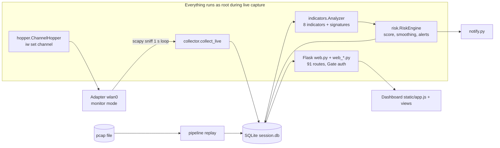
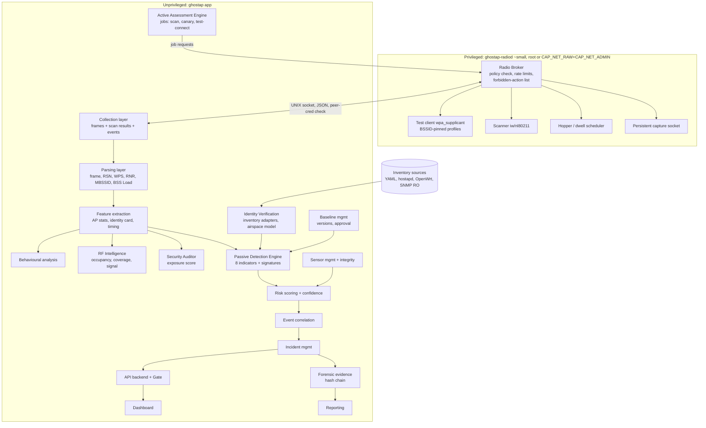
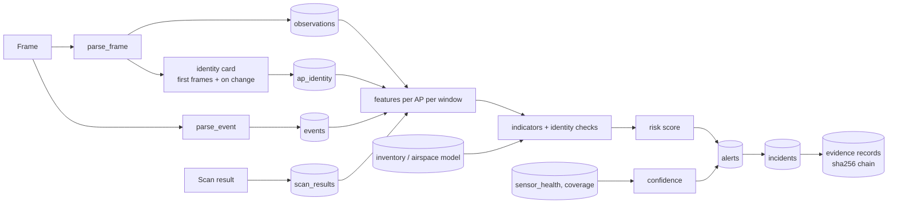
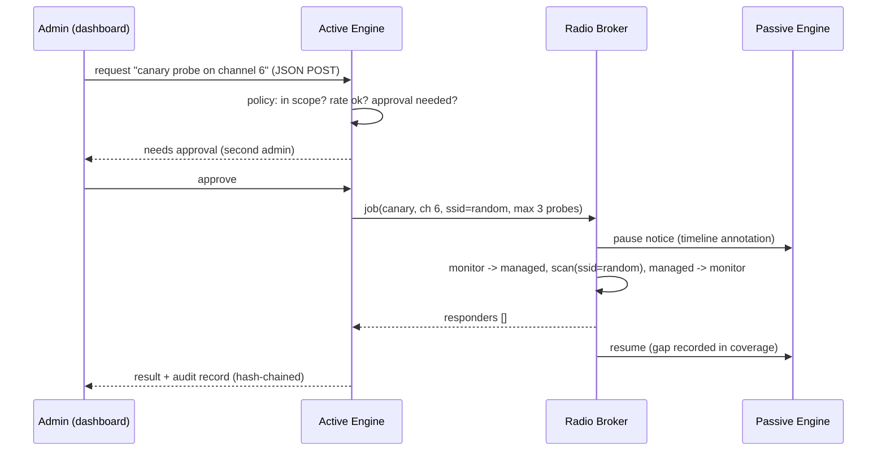
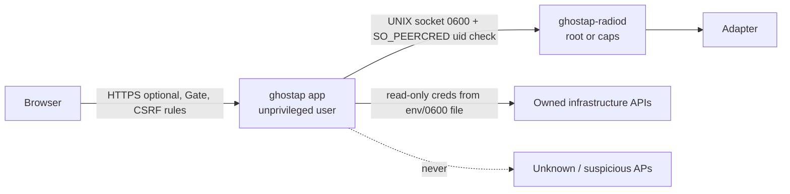

# GhostAP 3.0: Audit, Capability Research and Feature Plan

> **Status (kept up to date).** Approved 14 Nov 2026: the positioning ("Wireless Intrusion Detection and
> Airspace Assurance"), the release order 2.1 → 2.2 → 3.0 → 3.1 → 3.2 → 4.x, and the top-10 list.
> Defaults until the owner decides otherwise: time-shared active work on the single adapter (a second
> adapter is recommended, needed from 3.1); approval rule configurable, admin-only by default and
> two-person when ≥ 2 admins exist. Not answered yet: an OpenWrt router or hostapd AP the owner controls
> (the hwsim lab's hostapd covers the demos meanwhile).
> - **2.1 (in progress):** done: deauth reason classes (leave reasons 3/8 count one third) and the channel-flip
>   sequence rule; persistent capture socket (L2, verified live: 2 kernel log lines per run instead of ~2/s);
>   5 GHz receive verified (75 s). The look-alike dual-band case waits for O2 (declared topology, 3.0).
>   Kismet comparison done (Kismet 2/3 twins, GhostAP 3/3, both 0 false alarms; reader confirmed on real
>   logs). 2.0 Phase 2 baseline integrity done (signed, versioned, approval-gated, contamination checks).
>   Still to do in 2.1: multi-hour soak (running), a 5 GHz run with a twin (needs the owner).
> - **2.2 (in progress):** O18 hardware capability intelligence done (`ghostap/hwcaps.py`, System page).
>   Next: 2.0 Phase 3 (persisted incidents, evidence records, hash-chained audit).

Research and planning only. Nothing in the repository, the database, the dependencies, the
wireless interface or Git was changed while preparing this plan (14 Nov 2026, `main` at `c736bb5`,
in sync with GitHub, CI green on Python 3.11–3.13 and Docker).

**Evidence labels:** **[V]** verified here (source read, command run or measured live) ·
**[R]** recommendation · **[A]** assumption · **[U]** unknown, needs a test.

---

## 1. Executive summary

GhostAP today is a mature **passive** wireless intrusion detector: 43 Python modules (~11,700 lines),
91 HTTP endpoints, 13 database tables, 11 dashboard pages and 247 passing tests **[V]**. The
roadmap's F001–F090 are built. On 14 Nov 2026 it was validated live for the first time on the
project's own sensor: 3 of 3 phone-hotspot twins caught, no GhostAP alert on 141 legitimate
APs, 4 real bugs found and fixed **[V]**.

**What the audit says about going "active":**

1. **The sensor is one radio, with no concurrent interfaces.** `iw` reports *"interface combinations
   are not supported"*, 1×1 antennas, no channel survey data, no Wi-Fi 6 (HE), no GCMP ciphers **[V]**.
   Active work (scans, a test client) therefore has to **time-share** the radio with passive
   monitoring, or use a **second low-cost adapter**. That choice shapes the whole 3.x architecture.
2. **The most valuable next step is not more transmitting. It is stronger identity evidence.**
   Beacons already carry information GhostAP names but does not use **[V]**: the WPS
   device-identity attributes, the Reduced Neighbour Report and Multiple-BSSID elements (in
   which a real AP *declares* its siblings), BSS Load and Country. Using them makes a twin forge
   far more, at zero transmit risk.
3. **Active capabilities worth building are narrow and defensible:**
   - an authoritative **inventory** (what *should* be on the air);
   - a policy-gated **radio broker** that also fixes "the whole app runs as root";
   - a **canary-probe KARMA test**;
   - a **BSSID-pinned test client**;
   - **closed-loop remediation**: an approved change on owned infrastructure, then confirmed on
     the air by the passive engine.
4. **The safest high-impact demonstrator is an isolated lab.** `mac80211_hwsim` ships with this
   kernel (installed, not loaded) and `hostapd` is installed **[V]**: real beacons from real AP
   software, on virtual radios that never touch real RF.

**Recommended positioning:** *GhostAP, a Wireless Intrusion Detection and Airspace Assurance
system.* It is passive by default, with authorized, policy-gated active verification. It is
**not** a WIPS: there is no over-the-air containment, by design.

**Recommended first build (3.0):**
- the radio broker and privilege split;
- the passive identity card (WPS + topology elements);
- the hwsim lab;
- sensor-health and coverage disclosure;
- the inventory.

The 2.0 phases still open (baseline integrity, persisted incidents, sensors, protocol, packaging)
remain prerequisites and are folded into the plan (section 18).

---

## 2. Existing project audit

### 2.1 Size and shape [V]

| Item | Value |
|---|---|
| Python package | 43 modules, ~11,700 lines; the largest are `indicators.py` 1,041, `web.py` 771, `storage.py` 642, `risk.py` 570 |
| HTTP API | 91 routes, grouped as: me 8, monitored 7, sensors 5, ap 5, alerts 5, users 4, settings 4, sessions 4, evaluation 4, … |
| Database | SQLite, 13 tables: observations, layouts, events, alerts, ap_profiles, ap_latest, risk_timeline, annotations, mutes, audit, api_keys, notify_state, notify_log; versioned migrations (`storage.py:224`, `MIGRATIONS`) |
| Dashboard | `static/app.js` core and 11 views (`static/views/*.js`); strict CSP, all JS local, Plotly served locally |
| Tests | 247 in 29 files (the largest: detection 34, foundations 15, hardening 15, indicators 14) |
| CI | ruff (incl. security rules), pip-audit, pytest on 3.11–3.13, evaluation smoke test, number sync, Docker build and health check |
| Dependencies | scapy, flask, waitress, cheroot, plotly, pyyaml, matplotlib, pillow (+ numpy via matplotlib); optional anthropic |

### 2.2 Capability classification

Status: **IMPL** = traced, wired to UI/API, tested · **IMPL-LIVE** = also validated on real radio
traffic · **PARTIAL** · **EXPERIMENTAL** (works in tests, depends on hardware/data never used) ·
**BROKEN** · **MISSING** · **DOC-ONLY**.

#### Detection

| Capability | Source | Status | Tests | Notes |
|---|---|---|---|---|
| Frame parsing, FCS/truncation rejection | `parser.py:251` `parse_frame`, `:313` `parse_event` | IMPL-LIVE | test_parser, test_hardening | 0 rejected frames in run3 |
| Security downgrade (+RSN detail, group cipher) | `indicators.py:377`, `parser.py:140` `parse_rsn` | IMPL-LIVE | test_detection | open twin caught live |
| New BSSID / OUI (locally administered) | `indicators.py:399` | IMPL-LIVE | test_indicators | phone random MACs flagged |
| Channel deviation | `indicators.py:421` | IMPL-LIVE | test_indicators | |
| RSSI jump | `indicators.py:448` | IMPL-LIVE | test_indicators | stats include off-channel frames (finding) |
| TSF uptime / resets | `indicators.py:482` | IMPL-LIVE | test_indicators | phone twins do not look freshly booted |
| Clock skew (F007) | `indicators.py:295` `relative_clock_skew_ppm` | PARTIAL | test_detection | fixed live; cloned-BSSID case untested live |
| Beacon fingerprint | `parser.py:79` `beacon_layout`, `indicators.py:638` | IMPL-LIVE | test_parser, test_detection | phone vs router differed live |
| BSSID conflict / two transmitters | `indicators.py:570`, `:533`, `:547` | PARTIAL | test_detection | channel-flip rule fired on a neighbour (one radio, continuous seq) |
| Beacon interval / rate | `indicators.py:612` | IMPL | test_detection | no anomaly seen live |
| KARMA / MANA | `signatures.py:126`, `indicators.py:804` `names_of` | IMPL (synthetic) | test_detection | passive only: sees a radio using ≥3 names |
| Look-alike names | `signatures.py:73` | PARTIAL | test_detection | flags one router's "X"/"X_5G" pair (floor 16) |
| Attack-tool fingerprints | `signatures.py:96,115`, `data/bandits.json` | PARTIAL | test_detection | library empty in live mode |
| Deauth / disassoc bursts | `risk.py:363` `DeauthDetector` | IMPL-LIVE | test_detection | benign reason-8 burst raised MEDIUM |
| Beacon flood | `risk.py:425` | IMPL (synthetic) | test_detection | |
| Hidden-SSID matching | `indicators.py:787` `_decloak` | IMPL | test_detection | |
| Risk score, smoothing, levels | `risk.py:97`, `:174` `RiskEngine` | IMPL-LIVE | test_risk, test_live_and_incremental | Σw = 15.5, MEDIUM ≥ 30, HIGH ≥ 60 |
| Duplicate-SSID comparison detector | `risk.py:300` | IMPL-LIVE | test_risk | flagged the real router every time (by design) |
| Incidents | `risk.py:472` `build_incidents` | PARTIAL | test_triage_ui_api | derived per request (`web_lab.py:96`, `web_ai.py:66`), not stored, no lifecycle |
| Saved baselines | `monitored.py`, `web_monitored.py` | PARTIAL | test_monitored_api | no versions / approval (2.0 Phase 2) |
| Wi-Fi 6/6E awareness | `parser.py:191` `_freq`, `beacon_layout` HE ext. | EXPERIMENTAL | test_detection | 6 GHz impossible on this adapter |
| Wi-Fi 7 / MLO | names only, `beacons.py:28-29` | MISSING | — | EHT / Multi-Link not parsed |
| WPS, BSS Load, Country, RNR, Multiple BSSID, Mobility Domain *values* | names only, `beacons.py:17-32` | MISSING | — | element **names** exist for display; values not parsed |
| Probe requests, auth/assoc frames | `collector.py:35` keeps subtypes 8, 5, 12, 10 | MISSING | — | by design (privacy); no counts either |

#### Platform

| Capability | Source | Status | Notes |
|---|---|---|---|
| Live capture + hopping + recording | `collector.py:68`, `hopper.py:64` | IMPL-LIVE, with a defect | **reopens the capture socket every second** (`collector.py:119-120`): the kernel logged ~9,990 "entered/left promiscuous mode" lines over the test, and each reopen leaves a receive gap **[V]** |
| Capture control (pause / hop) | `capture.py:14`, `web_sensors.py` | EXPERIMENTAL | not used from the dashboard live |
| Sessions, bundles (SHA-256 manifest) | `sessions.py:98,191,225` | IMPL | |
| Evidence pcap | `web_ap.py:197` | IMPL | no hash in the response |
| Alerts, triage, bulk, history, mutes | `web.py:429`, `web_admin.py` | IMPL | no "resolved" state |
| Auth: keys, accounts, 2FA, viewer links, HTTPS | `web_auth.py:41` `Gate`, `auth.py`, `tls.py` | IMPL | |
| Notifications, SIEM/CEF, metrics, OpenAPI | `notify.py`, `web_integrations.py` | IMPL (local fakes) | |
| Multi-sensor + location | `sensors.py:95,188` | PARTIAL | one sensor owned; location geometry only |
| Ownership after sudo | `ownership.py:55` | IMPL | |
| ML: learned weights, anomaly model | `stats.py:114,141` (numpy) | EXPERIMENTAL | synthetic only |
| Kismet comparison | `kismet.py` | EXPERIMENTAL | Kismet **is installed** on this Kali **[V]**: can now be validated |
| AI explainer | `ai.py`, `web_ai.py` | EXPERIMENTAL | opt-in |
| systemd / Docker | `deploy/`, `Dockerfile` | systemd EXPERIMENTAL; Docker IMPL (built in CI) | |
| **Active scanning, nl80211, test client, SNMP/controller APIs, remediation** | — | **MISSING** | `grep` finds none in `ghostap/` or `tools/` **[V]** |

**Broken:** none functionally. All tests pass. The open defects are listed in 2.3.

### 2.3 Architectural limitations found

| # | Limitation | Evidence | Consequence |
|---|---|---|---|
| L1 | The whole application runs as root during live capture | live test; `README` / KALI_SETUP commands | web server, parsers and auth all run privileged |
| L2 | The collector reopens its socket every second | `collector.py:119-120`; kernel log | log spam, frame gaps, CPU churn |
| L3 | One process owns the radio implicitly | `pipeline.py:125` starts `collect_live` | nothing can arbitrate passive vs. active use of the adapter |
| L4 | Evidence is about the frame, not the device | indicators use structure hash, OUI, RSSI, TSF | twin needs to match only a hash; identity fields inside WPS / RNR are ignored |
| L5 | No notion of "expected" airspace beyond learned baselines | `monitored.py` | cannot say "this BSSID is not in our inventory" with authority |
| L6 | No sensor self-assessment | live clock-slew + off-channel findings | sensor problems become false evidence (two bugs found live) |
| L7 | No coverage accounting | hopping is reported, dwell is not stored | an alert cannot say "5 GHz was never monitored" |
| L8 | Flat package layout | 43 modules in `ghostap/` | fine for now; new subsystems should get sub-packages |

---

## 3. Hardware and driver capability report

Read-only inspection: `lsusb`, `iw dev`, `iw phy phy0 info`, `ethtool -i`, `modinfo`, `rfkill`,
`iw dev wlan0 survey dump`, `journalctl -k`. No mode changes, no scans.

| Item | Value |
|---|---|
| Adapter | TP-Link Archer T2U Plus, USB `2357:0120` |
| Chipset / driver | Realtek RTL8821AU, out-of-tree `88XXau` `v5.6.4.2_35491.20191025` (Kali package `realtek-rtl88xxau-dkms 5.6.4.2~git20240726`), DKMS module, kernel taint (unsigned) |
| Firmware | built into the driver (ethtool reports none); `firmware-realtek 20230625` installed |
| Kernel | 6.8.11-arm64 (in-kernel `rtw88` support for this chip needs ≥ 6.14) |
| Host | VMware VM, 2 vCPU, 3.9 GB RAM, USB pass-through |

### Capability matrix

| Capability | Advertised by driver | Verified live | Implication |
|---|---|---|---|
| Monitor mode | yes | **yes** (2.4 GHz, 80 min, stable) | passive engine OK |
| Managed (client) mode | yes | yes (NetworkManager, not connected) | test client possible |
| AP mode (`start_ap`) | yes | **no** | GhostAP should not use it (no rogue APs); lab uses hwsim instead |
| Concurrent interfaces (AP+monitor, managed+monitor) | **"interface combinations are not supported"** | n/a | **no simultaneous active + passive on one radio** |
| Extra monitor interface ("software interface modes: monitor") | yes | no | would share the radio's channel; no independent hopping **[A]** |
| 2.4 GHz channels | 1–14 | 1–13 hopped | |
| 5 GHz channels | 36–177 listed (reg. domain `00`) | **no** | next live test |
| 6 GHz | no | — | no 6E / Wi-Fi 7 validation on this hardware |
| HT / VHT | HT20/40, VHT (433 Mbps) | — | |
| HE / EHT (Wi-Fi 6/7) as a station | **no** | — | beacons' HE/EHT elements can still be *decoded* passively (beacons use legacy rates) |
| Antennas | TX 0x1 / RX 0x1 (1×1) | — | **no direction finding** |
| Ciphers | WEP40/104, TKIP, CCMP-128, CMAC | — | test client **cannot** join GCMP / CCMP-256 / WPA3-Enterprise-192 networks |
| SAE (WPA3-Personal) client | "SAE with AUTHENTICATE command" | no | WPA3-Personal test client possible **[U]** |
| Active scan | max 9 SSIDs per scan; **no scheduled scan, no match sets** | not run | scans are triggered from user space in managed mode |
| Channel survey (busy time) | — | **0 entries** | **no channel utilisation from the sensor**; use the BSS Load element APs advertise, plus frame counts |
| Frame TX | all management subtypes in AP / managed modes; driver has injection parameters (`rtw_monitor_*`) | not used | GhostAP must never use them for attack traffic; policy-enforced (section 13) |
| Driver stability | — | no resets/disconnects in ~80 min; only the taint warning | 5 GHz and multi-hour soak untested |
| GhostAP collector compatibility | — | yes, with defect L2 | |

**Other tools on this Kali [V]:** iw, nmcli, wpa_supplicant/wpa_cli, hostapd, tshark, kismet,
airodump-ng, snmpget, `mac80211_hwsim` (module present, not loaded). Python in `.venv`: numpy only;
**not** installed: pyroute2, scikit-learn, networkx, pysnmp, PDF libraries.

---

## 4. Current passive engine assessment

**Strengths [V]:** explainable additive score, byte-reproducible evaluation, incremental scoring
equal to one-shot, bounded memory, strict web security, and live validation:
- 18.4 s mean latency;
- WPA2 and open twins caught;
- the fingerprint recognised the same phone across MAC randomisation.

**Weaknesses [V]:**
- **Thin margin on same-security twins** (live 31.5–38.1 vs threshold 30).
- **The s11 blind spot** (a structure-copying twin).
- **Evidence is mostly frame-level.**
- Sensor artefacts can become evidence (clock slew, off-channel: both fixed, but the class of
  problem remains).
- Several benign false-positive sources: dual-band look-alikes, leave-reason deauth bursts,
  channel-flip on automatic channel selection.

**Implication [R]:** the next gains come from **identity evidence a twin must forge field by
field** and from **knowing what should be there** (inventory). New weighted indicators would only
add more of the same frame-level evidence.

---

## 5. Active wireless capabilities (Part 3 research)

Each direction: what it is, feasibility on **this** hardware, what is passive vs. needs
admin access or an authorized client, and a recommendation.

### A. Active wireless discovery

- **How it differs from monitor mode.**
  - *Monitor capture* receives every frame on the tuned channel, with radiotap metadata, and sends
    nothing.
  - *Active scanning* (nl80211 `TRIGGER_SCAN` in managed mode) sends probe requests on each channel
    and returns the kernel's BSS table: BSSID, SSID, frequency, signal, the information elements of
    the last beacon / probe response, and the age.
  - Scanning is fast (all channels in a few seconds) but coarse. It gives one snapshot per BSS, not
    a frame stream, and no sequence numbers or timing.
- **Value over GhostAP's passive view:**
  - responders to *directed* probes, including APs that answer probes but beacon rarely or not at all;
  - a quick 5 GHz / DFS inventory without long dwell;
  - a second, independent view to cross-check the passive one.
- **Python interfaces.** Two options:
  - `pyroute2` (a pure-Python nl80211 client: new dependency, not installed);
  - calling `iw dev <if> scan` / `scan dump` and parsing the text (no dependency, fragile).
  - **[R]:** `iw` first, behind an adapter interface; pyroute2 later if needed.
- **On this hardware:** a scan needs managed mode → **capture must pause**. One scan of 13 + 25
  channels ≈ 3–6 s **[A]**. Mode switches on 88XXau are untested **[U]**. A **second adapter**
  removes the conflict.
- **Controls [R]:**
  - scheduled inventory refresh (default **off**, minimum interval 15 min);
  - directed probes only for SSIDs in the configured scope;
  - no scanning of networks outside scope (results filtered before storage);
  - scan windows written to the timeline (like F041 pauses);
  - the driver offers no random-MAC scanning (extended features list is empty **[V]**), so probes
    carry the adapter's MAC: document it.

### B. Automated Wi-Fi security auditor (posture)

| Check | Passive (beacons) | Needs a test client | Needs admin access |
|---|---|---|---|
| WPA2 / WPA3-SAE / transition mode | ✅ RSN AKMs (parsed today) | confirms the negotiated AKM | — |
| WPA3-Enterprise / 192-bit | ✅ AKM 12/13 advertised | ❌ this adapter lacks GCMP-256 | — |
| PMF capable / required | ✅ RSN capabilities (parsed) | confirms | — |
| Pairwise / group / group-mgmt ciphers | ✅ (parsed since 2.0 Phase 0) | — | — |
| TKIP anywhere | ✅ | — | — |
| WPS enabled / configured / AP setup locked | ✅ WPS element (**not parsed yet**) | — | PIN method details |
| WPS device identity (manufacturer, model, serial, UUID) | ✅ WPS element (**not parsed yet**) | — | — |
| 802.11r / 11k / 11v | ✅ Mobility Domain, RM caps, Ext caps (**names only today**) | roaming test | — |
| Country / regulatory consistency | ✅ Country element (**not parsed**) | — | — |
| Hidden SSID | ✅ | — | — |
| Band support (2.4/5/6) | ✅ per BSSID; 6 GHz needs a 6E sensor (or RNR hints) | — | — |
| Wi-Fi 6E / 7, MLO | ✅ HE/EHT/Multi-Link elements (EHT **missing**) | ❌ (no HE/EHT client) | — |
| Admin password, firmware version, remote admin, WPS PIN brute-force resistance | ❌ | ❌ | ✅ only via owned infrastructure APIs |

**[R]:** a **passive Exposure Score per owned network**, with evidence per finding, the
passive/client/admin column shown in the UI, and remediation text. This is distinct from F035
(network *twin-risk* score).

### C. RF intelligence and spectrum

- **The adapter cannot measure spectrum.** Survey dump is empty **[V]** and there is no SDR. Non-Wi-Fi
  interference (microwave ovens, Bluetooth) is invisible. Any "spectrum analysis" claim would be false.
- **What is honest and feasible:**
  1. **Channel occupancy from the APs' own reports.** The BSS Load element (ID 11) carries station
     count and channel utilisation as measured by each AP. It is passive, real, and not parsed yet.
  2. **Frame-level occupancy:** beacons/second and APs per channel per dwell.
  3. **Signal stability per AP** (on-channel frames only, as fixed live).
  4. **Coverage accounting:** dwell seconds per channel per session.
  5. **Sensor placement advice** from per-AP signal of owned APs, labelled "relative, single sensor".
- **Visualisation:** Plotly (already vendored): heatmaps of channel × time, per-AP signal
  violin/box charts.
- **Group C:** true spectrum analysis (needs an SDR) and direction finding (needs ≥ 2 antennas or
  several sensors).

### D. Network intelligence graph

- **Nodes:** SSID, BSSID, vendor/OUI, device identity (WPS UUID / model), channel, security profile,
  sensor, alert, incident, session.
- **Edges:**
  - advertises (BSSID → SSID);
  - built-by (BSSID → device identity);
  - declares-sibling (from RNR/MBSSID);
  - seen-by (→ sensor);
  - flagged-in (→ alert/incident);
  - changed-to (identity version → identity version).
- **Storage:** SQLite is sufficient. A few hundred to a few thousand nodes are handled with plain
  tables plus recursive CTEs, and a graph DB (Neo4j) would add an always-on service for no gain
  **[R]**. Visualisation needs a graph library vendored locally (e.g. Cytoscape.js, MIT): a new static
  dependency, kept local because of the CSP.
- **Suspicious patterns made visible:**
  - one device identity under many SSIDs (KARMA-like);
  - one SSID with BSSIDs that are not declared by any sibling;
  - identity fields changing on one AP but not its siblings;
  - the same phone fingerprint re-appearing under new random MACs (seen live).

### E. Active network identity verification

| Source | Strength | Feasibility here |
|---|---|---|
| **Manual inventory** (YAML/CSV: SSID, BSSIDs, bands, channels, security, model) | authoritative if maintained | ✅ trivial; extends `monitored.json` |
| **hostapd control interface** (`hostapd_cli status`) | authoritative for hostapd APs | ✅ in the hwsim lab |
| **OpenWrt ubus / iwinfo over JSON-RPC** | authoritative | ✅ if an OpenWrt router exists **[U]** |
| **SNMP read-only** (IEEE802dot11-MIB, vendor MIBs) | depends on vendor | `snmpget` installed; pysnmp not; the owner's TP-Link consumer router likely has no SNMP **[A]** |
| **Controllers** (UniFi, Omada, Aruba Central, Meraki) | strong | needs those products (Group B) |
| **Wired correlation** (switch MAC table vs BSSID ± offset → rogue-on-wire) | classic WIPS signal | needs a managed switch + SNMP (Group B) |

**Rule [R]:** a BSSID advertising an owned SSID is *verified* only if an authoritative source lists
it and its passive identity (structure, WPS identity, declared siblings) matches. Otherwise it is
*observed-unverified*.

Constraints:
- never connect to a suspicious AP;
- infrastructure credentials only from environment variables or a 0600 file, never in the repo or
  database;
- every pull is read-only.

### F. Wi-Fi client security diagnostics (test client)

- **What it is:** a `wpa_supplicant` instance driven by GhostAP, connecting **only** to network
  profiles explicitly configured as test targets, **pinned to inventory BSSIDs** (`bssid=` in the
  profile) so it can never associate with a look-alike.
- **Checks:**
  - negotiated key management / ciphers / PMF (`wpa_cli status`);
  - DHCP lease vs expected subnet;
  - gateway MAC vs inventory;
  - DNS servers vs expected;
  - a captive-portal probe (HTTP GET to a known "204" endpoint: observes redirects, submits
    nothing);
  - a TLS certificate pin check of one known host;
  - connect time and roaming time between owned BSSIDs.
- **On this hardware:** CCMP and SAE only. A single radio means pausing passive capture, and
  leaving NetworkManager unmanaged for that interface **[A]**. **[R]:** second adapter.
- **Excluded:** connecting to unknown or suspicious APs, credential entry on portals, traffic
  capture of other users.

### G. Defensive response

| Action | Exists | New |
|---|---|---|
| Notifications (desktop, webhook, ntfy/Telegram, email, syslog/CEF) | ✅ `notify.py` | — |
| Evidence preservation | partial (evidence pcap, bundles with SHA-256) | auto-snapshot on alert: pcap slice + identity card + hashes into a sealed evidence record (2.0 Phase 3) |
| Incident creation | derived only (`risk.py:472`) | persisted incidents (2.0 Phase 3) |
| Inventory updates | accept-into-baseline (F017) | approval-gated, versioned (2.0 Phase 2) |
| **Infrastructure playbooks** | ❌ | approval-gated changes on owned APs via adapters (hostapd/OpenWrt first). Examples: require PMF, disable WPS, change channel, rotate a guest PSK. Dry-run diff, two-person approval option, audit, stored "before" state for rollback |
| **Closed-loop verification** | ❌ | after a change, the passive engine checks the air shows it (e.g. the beacons now advertise PMF required) and annotates the incident |

**Excluded by design:** jamming, deauthentication (including "containment" of rogue clients),
spoofed frames, MITM, credential capture.

### H. Advanced threat detection

| Threat | Today | Improvement [R] |
|---|---|---|
| Rogue AP (unauthorized, any SSID) | only same-SSID twins / look-alikes | inventory + "unknown AP with a strong signal near the sensor" + optional rogue-on-wire (Group B) |
| Deauth / disassoc anomalies | ✅ live | reason-class model: forced (6, 7) vs leave (3, 8) vs login-failure (15, 16, 23); **twin-rejection correlation** (below) |
| Management-frame floods | beacon + deauth | count-only probe-request / auth / assoc rates per channel (no client MACs stored) |
| Beacon flooding | ✅ (synthetic) | validate in hwsim lab |
| KARMA / MANA | passive name counting | **canary-probe test** (active, approved), plus probe-response-only responders |
| MAC impersonation | `bssid_conflict` | sequence-continuity rule (one radio = continuous counter; finding 3 of the live test), identity-card mismatch on a known BSSID |
| SSID spoofing / look-alikes | ✅ | dual-band pair exemption only when **declared** by the AP (RNR / MBSSID / same WPS UUID), not just by near-identical MAC (evasion-safe) |
| Security downgrade | ✅ live | add WPS-state and transition-mode downgrades |
| Suspicious roaming | — | aggregate only: reason-3 bursts on the real AP + reason-15 bursts on a same-name new AP = clients being pulled to a twin |
| Baseline poisoning | learned-as-normal limitation | 2.0 Phase 2 + inventory: a learned AP not in the inventory stays "unverified" |
| Configuration drift | fingerprint change on known BSSID (0.6) | element-level drift journal with **fleet-consistency** (all APs of a model change together = firmware update) |
| Multi-BSSID inconsistencies | — | parse MBSSID (71) / RNR (201); a BSSID claiming membership not reciprocated |

**Twin-rejection correlation (new, live-observed):** in run2 a WPA2 twin sent 137 reason-15
(4-way-handshake timeout) frames while the real AP saw 125 reason-3 departures **[V]**. A same-SSID
new BSSID that keeps failing handshakes with clients that hold the real PSK **does not know the
PSK**, which is direct evidence it is not part of the network. It is passive, cheap, and validated
by real data.

### I. Controlled simulation laboratory

- **Basis:** `mac80211_hwsim` creates virtual radios inside the kernel. `hostapd` runs real AP
  software on them; a hwsim radio in monitor mode feeds GhostAP's normal collector. Frames go only
  between hwsim radios, never to real RF **[V for module presence; behaviour [A] until run]**.
- **Scenarios** (as configs):
  - legit WPA2 AP;
  - open twin, WPA2 twin with another PSK, twin on another channel;
  - cloned BSSID (hostapd `bssid=`);
  - structure-copying twin (s11, via hostapd `vendor_elements`);
  - WPS on/off;
  - 802.11r;
  - a KARMA-style responder (a scripted probe responder on a hwsim radio);
  - beacon flood (many hostapd BSSes).
- **Grading:** expected outcome per scenario → the same labels / `evaluate.py` pipeline →
  regression results. This is the third dataset class: *real AP software on simulated radio*,
  between the synthetic set and live captures.
- **Safety [R]:**
  - the lab tool refuses to start unless every interface it touches is a hwsim radio (driver name
    check);
  - loading the module needs root: the operator runs it, as with monitor mode.
- **CI:** GitHub-hosted runners may not ship `mac80211_hwsim` **[U]**; run the lab locally and keep
  its recorded pcaps as fixtures.

### J. Machine learning and behavioural analytics

- **Existing:** logistic-regression weights and a numpy anomaly model (`stats.py:114,141`), both
  offline and synthetic. scikit-learn is not installed **[V]**.
- **Where ML genuinely helps:**
  - per-AP **behavioural profiles** (beacon timing jitter in TSF units, on-channel RSSI
    distribution, probe-response vs beacon structure) with robust statistics (median/MAD, EWMA);
    explainable and needing no library;
  - **calibration** of the rule score into a probability once real labels exist.
- **Where it does not help (yet):**
  - Isolation Forest / XGBoost on 3 real twins is meaningless;
  - deep models cannot be explained in the alert format users rely on.
- **[R]:** keep rules primary. Add an ML side-score only when the real + hwsim + AWID3 dataset meets
  the 2.0 acceptance gate (improves recall at equal FPR).

### K. Incident response and forensics

- **Exists:** evidence pcap, bundles with SHA-256 manifest, audit log, triage history, HTML session
  report.
- **Planned in 2.0 Phase 3:** persisted incidents, lifecycle, custody, exports.
- **3.x additions [R]:**
  - **hash-chained audit** (each record includes the previous hash; stdlib only);
  - **evidence records** that bundle pcap slice + identity card + scores + sensor-health snapshot,
    so the report can show the sensor was trustworthy at the time;
  - **session diff** ("airspace then vs now");
  - JSON/CSV exports (PDF last, as you decided).

---

## 6. Additional threat-detection ideas (summary)

1. Twin-rejection correlation (reason 15/16/23 from a same-SSID unverified BSSID). Live-backed.
2. Client-pull indicator (departure bursts on the real AP while a same-SSID AP appears). Aggregate,
   no client MACs.
3. Sequence-continuity rule for BSSID conflicts.
4. Probe-response vs beacon consistency per BSSID.
5. Declared-topology mismatch (RNR / MBSSID / Mobility Domain).
6. Device-identity mismatch on a known BSSID (WPS UUID / model / serial changed).
7. Fleet-inconsistent drift (one AP of a model changes, its siblings don't).
8. Count-only management-frame flood rates (probe req / auth / assoc).
9. Canary-probe responders (active).
10. Country / regulatory element inconsistent with siblings.

---

## 7. Original feature proposals (Part 4)

Each has a technical purpose and builds on something that exists or was found live.

| # | Feature | Purpose | Builds on |
|---|---|---|---|
| O1 | **Passive Device Identity Card** | Parse WPS attributes (manufacturer, model name/number, serial, UUID, device name), HT/VHT/HE capability fields and vendor elements into a per-BSSID identity. A twin must forge each field; changes on a known BSSID are explained field by field | `beacon_layout`, `beacons.py` names |
| O2 | **Declared-Topology Cross-Check** | Real APs declare co-located BSSIDs (RNR 201, Multiple BSSID 71, Mobility Domain 54). A same-SSID BSSID nobody declares, which declares nobody, is *unendorsed*. It also gives an evasion-safe exemption for "X"/"X_5G" pairs | parser |
| O3 | **Radio Broker (privileged micro-daemon)** | A tiny root/capability process owns the adapter (capture, hop, scan, test client) behind a local socket with a policy check; the web app runs unprivileged. Fixes L1-L3 and is the only door for active actions | `collector`, `hopper`, `capture` |
| O4 | **Sensor Integrity Monitor** | Detects the sensor problems found live as *sensor* conditions, not AP evidence: common-mode clock slew across APs, off-channel share, socket churn, regulatory domain `00`, driver resets. Feeds a sensor trust level into alerts | live findings, `relative_clock_skew_ppm` |
| O5 | **Coverage & Blind-Spot Disclosure** | Store dwell per channel and band; every alert and report states what was *not* monitored (e.g. "5 GHz: 0 s") | `hopper.describe` |
| O6 | **Evidence Confidence** | Separate "how suspicious" (score) from "how sure" (frames, on-channel share, sensor trust, baseline age, coverage). E.g. "MEDIUM, low confidence: 9 frames" | risk engine |
| O7 | **Airspace Model** (expected-state "digital twin" of *your* network) | A versioned declarative model: inventory + approved baselines + identity cards + declared topology. Continuous diff against the air drives drift, rogue and twin verdicts | 2.0 Phase 2 baselines |
| O8 | **Twin Rehearsal Lab** | One command builds hwsim radios + hostapd scenarios with knobs (copy OUI, channel, PSK, beacon structure, BSSID), runs GhostAP and prints a scorecard. An exhibition "try to fool GhostAP" game, fully isolated | evaluate.py, labels |
| O9 | **Evasion Distance (counterfactual explanations)** | For each alert: the cheapest set of attributes an attacker would have to fake to stay below the threshold. For each owned network: how many forgeries an undetected twin needs, and which settings raise that (enable PMF, RNR, WPS identity) | what-if engine (F031) |
| O10 | **Twin-Rejection Correlation** | Handshake-failure bursts from an unverified same-SSID BSSID as identity evidence (section 5H) | DeauthDetector |
| O11 | **Canary-Probe KARMA Test** | Approved, rate-limited directed probe for a random never-used SSID; any responder is a KARMA/MANA AP. Normal client behaviour, no attack traffic | radio broker |
| O12 | **Closed-Loop Remediation** | Approved change on owned AP → passive confirmation on air → incident annotated "fixed and verified at T"; rollback stored | inventory adapters, notify |
| O13 | **Fleet-Aware Drift Journal** | Element-level change log; changes shared by all APs of one model in a short window are classed as fleet updates (benign); lone changes are suspicious | beacon diff (F028) |
| O14 | **TSF Timebase for Multi-Sensor** | Sensor clocks proved unreliable live; APs' TSF counters are shared, precise clocks. Align events across sensors via common APs' TSF instead of NTP | `relative_clock_skew_ppm`, sensors |
| O15 | **Suspicion-Driven Dwell** | When an AP crosses a "watch" level, the hopper dwells on its channel to gather evidence faster (live latency 22 s; target ≤ 12 s) | smart hopping (F043) |
| O16 | **Wireless Exposure Score** | Passive posture per owned network (section 5B) with passive/client/admin evidence classes and remediation | parse_rsn |
| O17 | **Privacy Scope Mode** | Non-owned networks stored as salted hashes and aggregated; reports show only owned networks in clear. Important for exhibitions in public places | scope config, ai.redact |
| O18 | **Hardware Capability Intelligence** | Parse `iw phy` at start; show the matrix on the System page; auto-mark features "not observable with this sensor" (6 GHz, survey, HE client) | System page |
| O19 | **Airspace Session Diff** | Compare two sessions: new/removed/changed APs and identity fields ("before vs after the event") | sessions |
| O20 | **Beacon Timing Signature** (experimental) | TBTT phase jitter measured in the AP's own TSF (sensor-clock-independent); software APs (hostapd on laptops) jitter more than hardware APs. A candidate for the s11 gap | TSF parsing |

---

## 8. Existing vs new comparison

| Area | Exists today | New in this plan |
|---|---|---|
| Identity | structure hash, OUI, TSF, relative clock skew | O1 identity card, O2 declared topology, O20 timing |
| Ground truth | learned / saved baselines | O7 airspace model + inventory adapters (E) |
| Sensor | capture quality panel (F042) | O4 integrity, O5 coverage, O18 capability |
| Explainability | per-indicator reasons, benign causes, what-if | O6 confidence, O9 evasion distance |
| Active | none | O3 broker, A scans, O11 canary, F test client, O12 remediation |
| Lab | synthetic byte templates, pcaps | O8 hwsim with real hostapd |
| Response | notifications, triage | O12 closed loop, evidence records (K) |
| Multi-sensor | reporting + trilateration | O14 TSF timebase |

---

## 9. Proposed architecture

**Microservices? No [R].** One sensor, 2 vCPUs, SQLite, a single developer: separate services would
add deployment, auth between services and failure modes, for no scaling need. **One split pays off:**
the **privilege boundary**. A small privileged *radio broker* plus the unprivileged application (a
modular monolith). Multi-sensor stays sensor → central over HTTPS (existing design).

### 9.1 Current architecture [V]



### 9.2 Proposed architecture [R]



### 9.3 Data flow [R]



### 9.4 Active / passive interaction (single radio) [R]



With a second adapter, the broker assigns roles (`passive`, `active`) and no pause is needed.

### 9.5 Database design (additions; via `MIGRATIONS`, never editing released ones) [R]

| Table | Key columns | Purpose |
|---|---|---|
| `ap_identity` | bssid, first_ts, last_ts, wps_uuid, wps_manufacturer, wps_model, wps_model_no, wps_serial_hash, wps_state, caps_hash, country, mdid, rnr_json, mbssid_json, bss_load_util | O1, O2, posture |
| `inventory_aps` | source, ssid, bssid, band, channel, security, model, verified_at | authoritative expected state |
| `inventory_sources` | name, kind (yaml/hostapd/openwrt/snmp), last_pull, status | adapters |
| `airspace_versions` | version, created_by, approved_by, sha256, json | O7 (with 2.0 baseline lifecycle) |
| `scan_results` | job_id, ts, bssid, ssid, freq, signal, ies_hash | active discovery |
| `active_jobs` | id, kind, params_json, requested_by, approved_by, state, started, ended, result_json | active engine |
| `policy` | action kind, scope, rate, approval rule | enforced by broker + app |
| `remediations` | id, incident_id, adapter, before_json, after_json, approved_by, applied_ts, verified_ts, rolled_back_ts | O12 |
| `sensor_health` | ts, clock_common_ppm, offchannel_share, socket_reopens, reg_domain, driver_events | O4 |
| `coverage` | session, channel, dwell_s, frames | O5 |
| `incidents`, `evidence` | (2.0 Phase 3) + prev_hash | K |
| `audit` | + prev_hash, hash | hash chain |

The graph (D) is **views** over these tables; no new store.

### 9.6 API design [R] (all JSON, same-origin, Gate roles; new admin endpoints added to `ADMIN_ONLY`)

| Endpoint | Method | Role |
|---|---|---|
| `/api/identity?bssid=` | GET | viewer |
| `/api/posture?ssid=` | GET | viewer |
| `/api/coverage`, `/api/sensor/health`, `/api/sensor/capabilities` | GET | viewer |
| `/api/inventory`, `/api/inventory/sources` | GET | analyst |
| `/api/inventory/pull` | POST | admin |
| `/api/airspace/diff?from=&to=` | GET | analyst |
| `/api/graph?ssid=` | GET | analyst |
| `/api/active/policy` | GET / POST | admin |
| `/api/active/jobs` | GET / POST (request) | admin |
| `/api/active/jobs/<id>/approve` | POST | admin (≠ requester if two-person on) |
| `/api/remediations` | GET / POST (propose) | admin |
| `/api/remediations/<id>/approve`, `/rollback` | POST | admin |

### 9.7 Hardware interaction design [R]

- **The broker is the only code that calls `iw`, opens raw sockets or starts `wpa_supplicant`.**
  - It keeps **one persistent capture socket** (fixes L2).
  - It runs the hopper, records dwell (O5), executes scan windows, and runs the test client in a
    dedicated network namespace or as an unmanaged NetworkManager interface **[A]**.
- **Capability probe at start:** it parses `iw phy` (O18) and refuses jobs the hardware cannot do.
- **Forbidden list, enforced in the broker and tested:**
  - frame injection in monitor mode;
  - deauth/disassoc transmission;
  - AP mode on any non-hwsim radio;
  - association to any BSSID not in an approved test profile.

### 9.8 Security boundaries [R]



### 9.9 Folder structure [R] (existing modules stay where they are; new subsystems get packages)

```
ghostap/
  (existing flat modules unchanged)
  radiod/        broker daemon: server.py, policy.py, capture.py, scan.py, testclient.py, caps.py
  active/        client.py (talks to radiod), jobs.py, canary.py, scheduler.py
  identity/      wps.py, topology.py (RNR/MBSSID/MDID), card.py, inventory/{yaml,hostapd,openwrt,snmp}.py
  assure/        posture.py, airspace.py, drift.py, confidence.py, sensorhealth.py, coverage.py
  lab/           hwsim.py, scenarios/*.conf, runner.py
  web_identity.py, web_active.py, web_assure.py   (same register() pattern as web_*.py)
deploy/ghostap-radiod.service
docs/PLAN_3.0.md, docs/ACTIVE_POLICY.md, docs/LAB.md
```

---

## 10. Database and API changes

See 9.5 and 9.6. Each table arrives with its migration and an old-schema test, following the
project rule. `data_version` is bumped when new state is shown. The evaluation outputs must stay
byte-identical unless a feature deliberately changes results, with extras behind `--extended`.

---

## 11. Dependencies

| Need | Option | Decision [R] |
|---|---|---|
| nl80211 scans | `iw` CLI (installed) vs `pyroute2` | start with `iw`; pyroute2 only if parsing proves fragile |
| Test client | `wpa_supplicant` / `wpa_cli` (installed) | no Python dependency |
| hwsim lab | kernel module + hostapd (installed) | none |
| SNMP | `snmpget` CLI (installed) vs `pysnmp` | CLI first |
| Graph view | Cytoscape.js (MIT), vendored locally | new static file |
| ML | numpy (present); scikit-learn only if the gate is met | defer |
| PDF | last, as decided | defer |

No paid services. Everything optional stays off by default.

## 12. Hardware requirements

| Tier | Hardware | Enables |
|---|---|---|
| Now | the existing T2U Plus | passive (2.4 + 5 GHz to validate), time-shared scans and test client, hwsim lab |
| Recommended (+1 low-cost adapter) | a second monitor-capable USB adapter (e.g. another RTL8821AU, or MT7612U) | concurrent passive + active; no capture gaps |
| Optional | MT7921AU-class (6 GHz) adapter | 6E / RNR-on-6 GHz validation |
| Optional | an OpenWrt-capable router | real inventory adapter + closed-loop remediation demo |
| Not needed | SDR, multi-antenna arrays, enterprise controllers | (Group C / B) |

---

## 13. Security and privacy considerations

- **Legal scope:**
  - active transmissions (even probe requests) only against owned/authorized networks, in a written
    scope (`docs/ACTIVE_POLICY.md`);
  - the policy file names SSIDs/BSSIDs;
  - everything else is passive-only.
- **Forbidden actions are code, not documentation:** the broker refuses them and tests prove it.
- **Two-person approval** for active jobs and remediations when ≥ 2 admins exist (as planned for
  baselines in 2.0).
- **Credentials** for infrastructure only from the environment or a 0600 file; never in the DB,
  logs or bundles. The test-client PSK is in the `wpa_supplicant` config, mode 0600, outside `data/`
  bundles.
- **Privacy:**
  - WPS serial numbers are stored hashed (salted);
  - non-owned networks are aggregated in Privacy Scope Mode (O17);
  - still no client MACs (the deauth model uses reason classes only);
  - probe-request counting is count-only.
- **Privilege:** root confined to the broker; the web app is unprivileged (L1).
- **Supply chain:** keep pip-audit; vendored JS pinned with SHA-256 in the repo.

## 14. Testing and validation

| Layer | Method |
|---|---|
| Parsers (WPS, RNR, MBSSID, BSS Load, Country, EHT) | hand-built byte vectors + ≥ 1 real capture per element; fingerprint-hash stability test |
| Identity / topology rules | synthetic fixtures + hwsim scenarios |
| Broker policy | unit tests: forbidden actions refused, scope and rate enforced, peer-cred check |
| Active jobs | fake broker in CI; hwsim locally (scan, canary, test client against hostapd) |
| Remediation | hostapd adapter in hwsim: apply → passive verification → rollback |
| Regression | existing 247 tests; byte-identical synthetic evaluation; live recordings (`data/lab_eval`, local) re-scored |
| Live | 5 GHz run, multi-hour soak (RSS, CPU, socket reopen count = 0), second-adapter concurrency |

## 15. Performance considerations

- Measured live: 14.7 % of one core and 113 MB at ~32 stored frames/s **[V]**.
- **Persistent capture socket:** expected to *lower* CPU and remove the per-second gaps **[A]**.
- **Identity card parsing:** only on an AP's first frames and on fingerprint change. The cost is
  bounded by the number of APs, not frames.
- **Active windows:** a 3–6 s capture gap each on one radio **[A]**. Defaults: off, ≥ 15 min apart,
  visible in coverage.
- **Graph / diff:** SQL over indexed tables. The 2.0 targets still apply (search < 200 ms at 10k incidents).

---

## 16. Feature scoring and prioritization

Scores 1–10. **Maint.** = maintenance burden (10 = heavy). **Total** = Tech + Unique + Useful +
Demo + Feasible − Maint.

| # | Feature | Status | Effort (dev-days) [A] | Tech | Uniq | Useful | Demo | Feas | Maint | Total |
|---|---|---|---|---|---|---|---|---|---|---|
| O3 | Radio broker + privilege split + persistent socket | missing (L1-L3) | 6–9 | 9 | 6 | 9 | 5 | 8 | 4 | **33** |
| O1 | Passive device identity card (WPS + caps) | missing | 4–6 | 8 | 8 | 8 | 8 | 9 | 3 | **38** |
| O2 | Declared-topology cross-check (RNR/MBSSID/MDID) | missing | 4–6 | 9 | 9 | 7 | 7 | 7 | 3 | **36** |
| O8 | Twin rehearsal lab (hwsim + hostapd) | missing | 5–8 | 8 | 8 | 8 | 10 | 7 | 4 | **37** |
| E | Inventory (YAML + hostapd + OpenWrt + SNMP RO) | missing | 5–8 | 8 | 6 | 9 | 7 | 7 | 5 | **32** |
| O4+O5+O6 | Sensor integrity, coverage disclosure, evidence confidence | missing | 5–7 | 8 | 9 | 8 | 7 | 8 | 3 | **37** |
| O16 | Wireless exposure (posture) score | partial (RSN parsed) | 3–5 | 7 | 6 | 9 | 8 | 9 | 3 | **36** |
| O10 | Twin-rejection correlation | missing (data live) | 2–3 | 7 | 9 | 7 | 7 | 9 | 2 | **37** |
| O11 | Canary-probe KARMA test | missing | 3–4 (after O3) | 7 | 8 | 7 | 9 | 7 | 3 | **35** |
| O12 | Closed-loop remediation (approval-gated) | missing | 6–9 | 8 | 9 | 7 | 9 | 6 | 6 | **33** |
| O9 | Evasion distance (counterfactuals) | partial (what-if) | 3–5 | 7 | 10 | 6 | 9 | 8 | 3 | **37** |
| O7 | Airspace model (expected state) | partial (baselines) | 6–9 (with 2.0 Ph. 2) | 8 | 7 | 8 | 6 | 7 | 5 | **31** |
| O13 | Fleet-aware drift journal | partial (F028 diff) | 3–5 | 7 | 8 | 7 | 6 | 8 | 3 | **33** |
| F | BSSID-pinned test client | missing | 6–8 | 7 | 6 | 7 | 7 | 6 | 5 | **28** |
| A | Scheduled active discovery | missing | 3–5 (after O3) | 6 | 4 | 6 | 5 | 7 | 4 | **24** |
| D | Intelligence graph view | missing | 4–6 | 6 | 6 | 6 | 9 | 7 | 4 | **30** |
| O15 | Suspicion-driven dwell | partial (F043) | 2–3 | 6 | 7 | 7 | 6 | 9 | 2 | **33** |
| O18 | Hardware capability intelligence | missing | 1–2 | 5 | 7 | 7 | 6 | 10 | 2 | **33** |
| O17 | Privacy scope mode | partial | 3–4 | 6 | 7 | 8 | 6 | 8 | 3 | **32** |
| O19 | Airspace session diff | missing | 2–4 | 5 | 6 | 7 | 7 | 9 | 2 | **32** |
| O14 | TSF timebase multi-sensor | missing | 5–8 | 8 | 10 | 5 | 6 | 5 | 5 | **29** |
| H-fl | Count-only mgmt-frame flood rates | missing | 2–3 | 5 | 4 | 6 | 5 | 9 | 2 | **27** |
| C-ld | BSS Load channel occupancy | missing | 2 | 5 | 5 | 6 | 6 | 9 | 2 | **29** |
| O20 | Beacon timing signature | missing | 5–8 | 8 | 9 | 5 | 5 | 4 | 5 | **26** |
| J | ML side-score | experimental | 8–12 | 6 | 4 | 5 | 6 | 3 | 7 | **17** |
| — | Rogue-on-wire (switch MAC tables) | missing | 5–8 | 7 | 5 | 7 | 5 | 3 | 6 | **21** |
| — | True spectrum analysis | missing | — (SDR) | 6 | 5 | 5 | 8 | 1 | 8 | **17** |
| — | Direction finding / precise location | partial (F045) | — | 6 | 6 | 5 | 9 | 1 | 8 | **19** |

**GROUP A: prioritise.** O1, O2, O3, O4/O5/O6, O8, O9, O10, O16, inventory (E), O18, O15.

**GROUP B: future releases.** O7 airspace model (with 2.0 Phase 2), O11 canary, O12 closed-loop
remediation, F test client, O13 drift journal, D graph, A scheduled discovery, O17 privacy mode,
O19 session diff, O14 TSF timebase, BSS Load occupancy, flood rates, rogue-on-wire, controller
integrations.

**GROUP C: not now.**
- True spectrum analysis (needs an SDR).
- Direction finding (1×1 radio).
- 6 GHz / Wi-Fi 7 validation (no hardware).
- ML beyond the 2.0 gate.
- A graph database.
- Microservices / message buses.
- Over-the-air containment (excluded).
- Client tracking or profiling (privacy).
- Automatic connection to unknown APs (excluded).
- PDF before the end (your decision).

---

## 17. Recommended top 10

1. **O3 Radio broker and privilege split.** It fixes three verified defects (root app, socket churn,
   no arbitration) and is the gate every active feature must pass through.
2. **O1 Passive device identity card.** It raises the forgery cost of a twin field by field, is
   passive, and its values are already in the beacons.
3. **O2 Declared-topology cross-check.** The real network vouches for its own BSSIDs, and it gives
   an evasion-safe fix for the dual-band look-alike false positive.
4. **O4 + O5 + O6 Sensor integrity, coverage and confidence.** This generalises the two live bugs
   into a feature, and makes every alert honest about what the sensor could see.
5. **O8 Twin rehearsal lab.** It gives reproducible real-stack tests (including the s11 case and
   cloned BSSIDs) with zero RF risk, and makes the best exhibition demonstration.
6. **Inventory (E), YAML + hostapd first.** "Verified vs observed-unverified" is the strongest
   answer to "duplicate SSID ≠ attack".
7. **O10 Twin-rejection correlation.** Backed by live data, cheap, and it adds evidence exactly
   where the margin is thinnest (same-security twins).
8. **O16 Wireless exposure score.** Immediate practical value for any owned network, with clear
   passive/client/admin labelling.
9. **O9 Evasion distance.** A unique, explainable answer to "how hard is my network to
   impersonate?"; it reuses the what-if engine.
10. **O11 Canary-probe KARMA test.** The first active feature: minimal transmission (normal probe
    requests), a high-confidence verdict, and fully policy-gated through O3.

Next in line: O12 closed-loop remediation (once an OpenWrt/hostapd target exists) and the
BSSID-pinned test client (once a second adapter exists).

---

## 18. Release roadmap

| Release | Content | Depends on | Effort [A] |
|---|---|---|---|
| **2.1, finish detection maturity** | Live-found fixes awaiting decisions (look-alike, deauth reason classes, channel-flip seq rule); **5 GHz live run**; **multi-hour soak**; Kismet comparison now possible; 2.0 Phase 2 (baseline integrity) | — | 8–12 |
| **2.2** | 2.0 Phase 3 (persisted incidents, evidence, custody, hash-chained audit); O18 capability intelligence | 2.1 | 10–14 |
| **3.0, Airspace Assurance** | O3 broker; O1 identity card; O2 topology; O4/O5/O6; O8 hwsim lab; inventory YAML + hostapd; O10; O16 | 2.2 | 30–45 |
| **3.1, Authorized Active** | O11 canary; scheduled discovery (A); BSSID-pinned test client (F); O9 evasion distance; O15 suspicion dwell | 3.0 + ideally a 2nd adapter | 18–26 |
| **3.2** | O12 closed-loop remediation (hostapd/OpenWrt); O7 airspace model; O13 drift journal; D graph; O19 diff; O17 privacy mode | 3.1; an OpenWrt or hostapd target | 25–35 |
| **4.x, Distributed + analytics** | 2.0 Phase 4 sensors + O14 TSF timebase; ML side-score (gate); controller integrations; 6E/Wi-Fi 7 with new hardware; rogue-on-wire | ≥ 2 sensors, dataset gate, hardware | open |

The 2.0 phases "Protocol" (EHT/MLO parsing) and "Packaging/docs" continue alongside. The EHT/MLO
parsing fits naturally into the identity/topology parser work of 3.0.

---

## 19. Outstanding risks

| Risk | Mitigation |
|---|---|
| 88XXau misbehaves on frequent monitor↔managed switches **[U]** | test in the 3.0 broker spike before committing to time-sharing; fall back to a 2nd adapter |
| hwsim behaviour / CI availability **[U]** | local lab; recorded hwsim pcaps as CI fixtures |
| WPS / RNR absent on the owner's router **[U]** | the identity card degrades gracefully; hwsim/hostapd provides elements for tests; record what real routers send |
| No API on the consumer TP-Link router **[A]** | YAML inventory + hostapd/OpenWrt adapters; the controller adapters stay optional |
| Legal / ethical perception of "active" features | passive by default, scoped policy file, forbidden-action tests, approval + audit, docs |
| Scope creep vs one developer, no deadline | release gates: each release ships with tests, docs, and live or hwsim validation |
| Identity fields can be forged too | treat identity as *cost* to the attacker, never as proof; keep the s11-style limitation visible |
| Team size unknown (two-person approval) | approval rule configurable: admin-only or two-person |

## 20. Recommended product direction

**GhostAP: Wireless Intrusion Detection and Airspace Assurance.**

- **Technically accurate:**
  - it *detects* (WIDS);
  - it *assures* that the airspace matches what the owner declared (inventory, identity, topology,
    posture);
  - it *verifies* through authorized, policy-gated active checks and owned-infrastructure changes.
- **Not a WIPS:** it does not prevent attacks over the air, and claiming that would be inaccurate
  and would require the excluded techniques.
- **Later ("Distributed Wireless Security Monitoring"):** only after ≥ 2 sensors exist and the TSF
  timebase and sensor fleet features are validated (4.x).

**Build first:** the 3.0 spike on **O3 (radio broker)** to answer the single-radio question with
real measurements. In parallel, **O1 + O2 parsing** and the **hwsim lab**, which need no new hardware
and no transmissions.

---

## Decisions needed from you

1. Approve the positioning ("Wireless Intrusion Detection and Airspace Assurance") and the 2.1 → 4.x order.
2. Second adapter: buy one (concurrent active + passive), or accept time-shared scans with capture gaps?
3. Do you have (or can you set up) an OpenWrt router or a hostapd AP you own, for inventory and remediation demos?
4. Two-person approval for active jobs/remediations, or admin-only (team size)?
5. The three pending design decisions from the live test: look-alike dual-band pairs (O2 makes this
   evasion-safe), deauth reason classes, channel-flip sequence rule.
6. May this plan be saved as `docs/PLAN_3.0.md` (and linked from CLAUDE.md), and committed?
