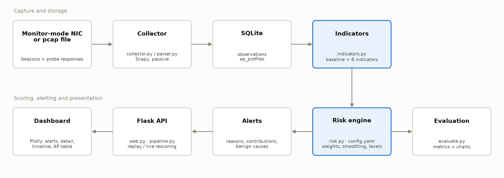
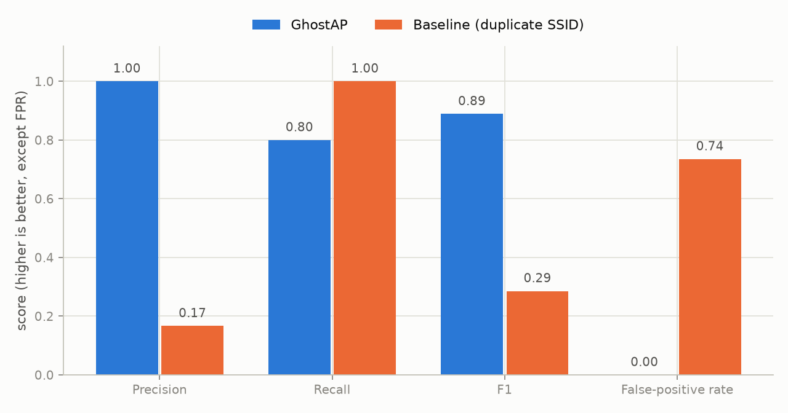
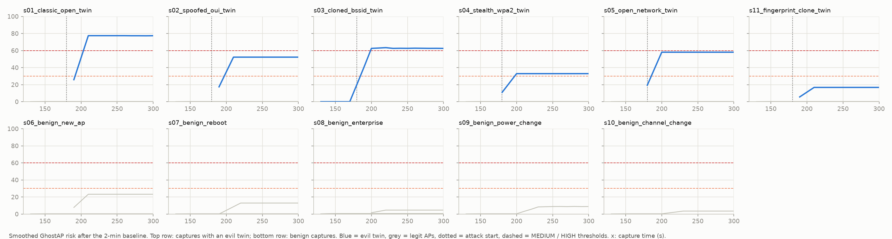
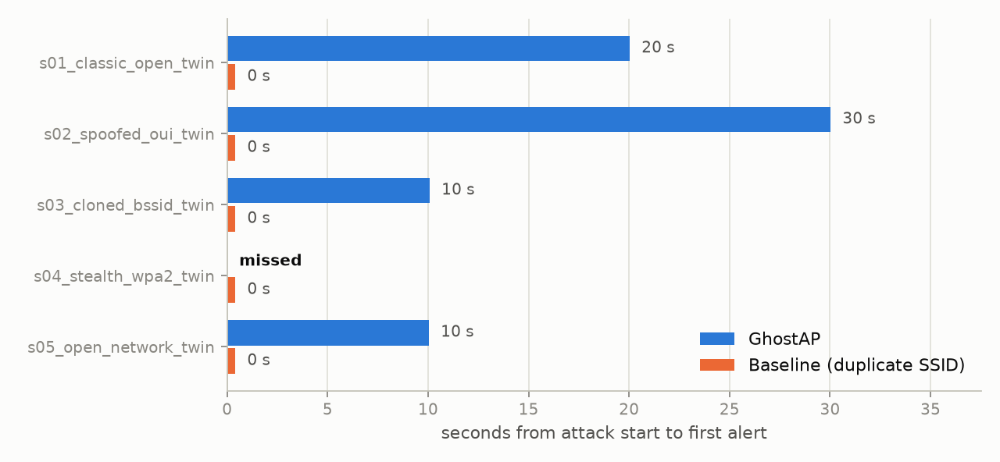
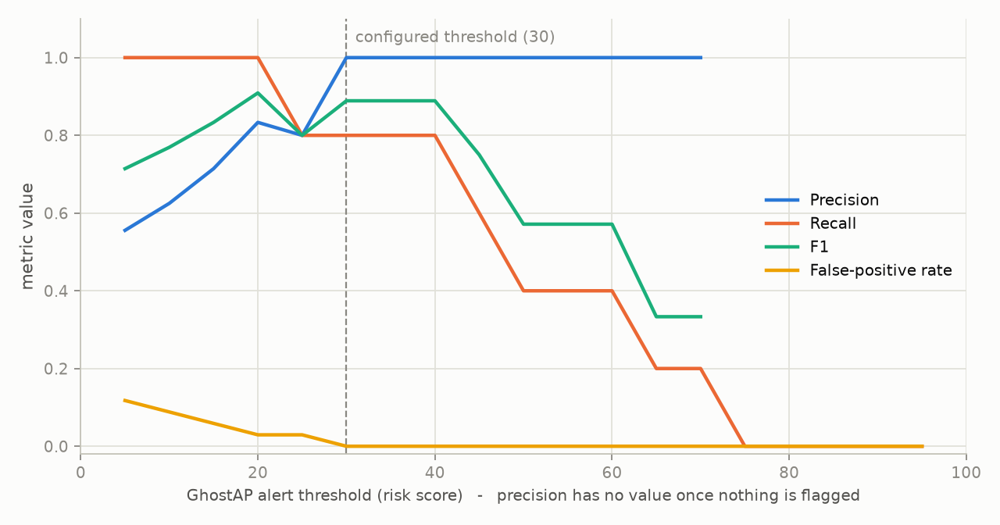

# GhostAP: Passive Detection of Evil Twin Wi-Fi Access Points Using Multi-Indicator Risk Scoring

**Project report**

| | |
|---|---|
| Team | _[Student name(s) and roll number(s)]_ |
| Guide | _[Guide name, designation]_ |
| Department / College | _[Department, college name]_ |
| Academic year | _[2026–27]_ |

> Items in _[brackets]_ are placeholders. Section 7.4 is reserved for the results on the
> real lab captures (Phase 2). Every other number in this report comes from
> `python evaluate.py` on the synthetic evaluation set and can be reproduced from the
> repository.

---

## Abstract

An *evil twin* is a rogue Wi-Fi access point that copies the network name (SSID) of a
legitimate network to lure clients into connecting, so the attacker can intercept their
traffic or capture credentials through a fake portal. GhostAP is a **passive** detector:
it only listens to 802.11 beacon and probe-response frames and never transmits, injects
or deauthenticates. Each access point (AP) is profiled, and eight indicators are
computed against a baseline learned from the first minutes of a capture: security
downgrade, new BSSID from an unfamiliar vendor, channel deviation, signal-strength
jump, TSF (uptime) anomaly, beacon-structure fingerprint, BSSID cloning, and
beacon-interval mismatch. They are
combined into a weighted risk score (0–100), smoothed over time so that a single odd
frame cannot raise an alert, and turned into explainable alerts. Each alert lists every
indicator's contribution, a reason in plain language, and possible benign causes. A
Flask + Plotly dashboard shows the results live during a pcap replay or a live capture,
with channel hopping and pcap recording for real deployments. Incremental scoring keeps
it responsive on long captures.

On a labelled synthetic set of 11 captures (43 APs, 6 evil twins), GhostAP reached
**precision 1.00, recall 0.83, F1 0.91 and a false-positive rate of 0.00**, with a mean
detection latency of 16 s. A baseline that flags every duplicated SSID reached
precision 0.18, F1 0.31 and a false-positive rate of 0.73. The beacon fingerprint
catches a WPA2 twin that copies the vendor prefix, channel and signal level. GhostAP
still misses an adaptive twin that also copies the real AP's beacon structure, leaving
only its uptime different. This is a fundamental limit of beacon-only detection.

---

## 1. Introduction

### 1.1 Problem

Wi-Fi clients choose networks largely by name. Any device can broadcast beacons that
advertise any SSID, so an attacker with a laptop or a cheap USB adapter can impersonate
a campus, office or café network. A client that connects to the impostor may send its
traffic through the attacker, enter credentials into a fake captive portal, or be
downgraded from WPA2 to an open network.

Large networks legitimately use many APs with the same SSID, so "the same name appears
twice" is not evidence of an attack on its own. A useful detector has to tell an
attacker's AP from the network's own extra APs without drowning the operator in false
alarms.

### 1.2 Objectives

1. Capture and store beacon / probe-response metadata passively.
2. Build per-AP profiles and learn what each network looks like during a baseline period.
3. Design indicators that capture how evil twins typically differ from legitimate APs.
4. Combine them into an explainable, time-smoothed risk score with alert levels.
5. Present the results on a dashboard that works on recorded and live captures.
6. Evaluate precision, recall, F1, false-positive rate and detection latency against a
   simple duplicate-SSID baseline.

### 1.3 Scope and ethics

GhostAP is strictly passive. It reads only management frames (beacons, type 0 subtype 8;
probe responses, subtype 5). It does not capture data frames or client traffic, transmit
anything, or interfere with any network. It is intended for networks the operator owns or
has written permission to monitor. Lab evil twins used for evaluation must be run only
on equipment and networks the team controls, in line with the college's policies and
applicable law.

---

## 2. Background

### 2.1 Beacon frames

APs announce themselves roughly ten times per second with beacon frames (and answer
client probe requests with probe responses carrying the same information). The
fields GhostAP uses are:

| Field | Where | Why it matters |
|---|---|---|
| SSID | information element 0 | the network name that the attacker copies |
| BSSID | MAC header (addr3) | the AP's radio MAC address; the first 3 bytes (OUI) identify the vendor |
| Channel | DS Parameter Set element | where the AP operates |
| Security | Capability "privacy" bit + RSN element (48) / WPA vendor element | open / WEP / WPA / WPA2 / WPA3 |
| TSF timestamp | beacon body, 64-bit µs counter | starts at 0 when the AP boots, so it reveals uptime |
| Beacon interval | beacon body, in time units (1 TU = 1.024 ms) | usually 100 TU; differs between devices and configs |
| Sequence number | MAC header, 12 bits | increments per transmitted frame; two radios sharing a BSSID produce interleaved counters |
| RSSI | Radiotap header (dBm antenna signal) | received signal strength at the monitor |
| Element layout | all information elements | order of elements, rate sets, HT/VHT capabilities and vendor elements differ between AP hardware and software |

### 2.2 Evil twin variants

- **Open twin of a protected network**: the most common case, because the attacker
  does not know the password. It is visible as a security downgrade.
- **Twin with a spoofed OUI or a cloned BSSID**: the attacker copies the vendor prefix
  or the full MAC of the real AP to look identical in scan lists.
- **Twin of an open hotspot**: no downgrade is possible, so other evidence is needed.
- **Twin with the real password**: e.g. a café PSK printed on the wall. Its beacons can
  be almost indistinguishable from the real AP's.

In all cases the attacker's device is usually closer to the victim than the real AP
(stronger signal), and it was usually switched on recently (low TSF).

### 2.3 Baseline approach

The simplest monitor flags an SSID as soon as more than one BSSID advertises it. It
catches every twin, but also flags every legitimate multi-AP network, which is almost
every campus and office. It is the comparison baseline in Section 7.

---

## 3. System design



*Figure 1: GhostAP architecture. The highlighted modules are the detection logic.*

| Module | Responsibility |
|---|---|
| `ghostap/parser.py` | Turn a Scapy packet into a flat observation; ignore everything except beacons and probe responses |
| `ghostap/storage.py` | SQLite tables `observations`, `ap_profiles`, `alerts`, `risk_timeline`; batched writes; WAL mode for concurrent reading |
| `ghostap/collector.py` | CLI for offline (`--pcap`) and live (`--iface`) collection |
| `ghostap/indicators.py` | Baseline learning and the eight indicators |
| `ghostap/risk.py` | Weighted score, temporal smoothing, levels, alerts, benign causes, duplicate-SSID baseline |
| `ghostap/pipeline.py` | Background ingest (replay paced by timestamps, or live sniffing) and incremental rescoring |
| `ghostap/hopper.py` | Channel hopping for live capture |
| `ghostap/web.py`, `ghostap/static/` | Flask JSON API and the dashboard |
| `ghostap/evaluate.py` | Metrics, threshold sweep and charts on labelled captures |
| `config.yaml` | Weights, thresholds and timing parameters |

The **unit of analysis** is one AP: a pair of SSID and BSSID. Two transmitters that
share a cloned BSSID therefore show up as one AP with conflicting behaviour, which is
exactly what the BSSID-conflict indicator looks for.

---

## 4. Implementation

### 4.1 Collection and storage

Scapy reads frames either from a pcap (`PcapReader`, streaming) or live (`sniff` with a
filter for type 0 / subtype 8 or 5 and `store=False`). For each frame, `parse_frame`
records: timestamp, frame type, SSID (`<hidden>` if empty), BSSID (lower case), OUI,
channel, security, RSSI, beacon interval, TSF, sequence number and a beacon
fingerprint (Section 4.3). It uses Scapy's
`network_stats()`. When several security options are advertised, it keeps the strongest
(WPA3 > WPA2 > WPA > WEP > open).

Observations are written in batches of 200 with parameterised queries. `ap_profiles` is
rebuilt with one `GROUP BY ssid, bssid` query: first and last seen, frame count,
distinct channels and securities, and RSSI min / max / average. If live capture fails
(no root, no monitor mode, wrong OS), the user gets a clear explanation instead of a
stack trace.

### 4.2 Baseline

The first *N* minutes of a capture (`baseline_minutes`, default 2) define normal. For
each SSID GhostAP records: the set of BSSIDs, OUIs and channels; each BSSID's channels
and RSSI mean / standard deviation; the strongest security seen; the mean RSSI of the
strongest AP; the most common beacon interval; and the set of beacon fingerprints. An
optional administrator allow-list (`known_bssids` in `config.yaml`) marks BSSIDs that are
known to be legitimate even if they appear later. Hidden SSIDs are never compared with
each other, because unrelated hidden networks all share the same placeholder name.

### 4.3 Indicators

Every indicator returns a value *x* ∈ [0, 1] and a human-readable reason.

| # | Indicator | Value |
|---|---|---|
| 1 | **Security downgrade** | weakest security seen vs. the SSID's baseline: one step down (WPA2 → WPA) = 0.5, two or more (→ WEP / open) = 1.0 |
| 2 | **New BSSID / vendor** | BSSID not in the baseline: same OUI = 0.3 (could be an added AP); unfamiliar OUI or locally administered MAC = 1.0 |
| 3 | **Channel deviation** | new BSSID on a channel the SSID never used = 1.0; known BSSID changed channel = 0.5 |
| 4 | **RSSI jump** | Δ = mean RSSI − reference (own baseline for a known BSSID, strongest baseline AP otherwise); *x* = (Δ − m) / 10, clipped to [0, 1], with margin m = max(6 dB, 3σ) |
| 5 | **TSF anomaly** | TSF reset (counter jumps back by more than 1 s) = 1.0; otherwise *x* = 1 − log₁₀(u+1) / log₁₀(U+1), where u = the AP's uptime when first seen and U = the longest uptime of a sibling AP at that moment |
| 6 | **Beacon fingerprint** | new BSSID whose beacon structure matches none of the SSID's baseline fingerprints = 1.0; a known BSSID whose structure changed = 0.6 |
| 7 | **BSSID conflict** | the same BSSID keeps alternating between channels within 5 s = 1.0; sequence numbers stepping backwards (≥ 3 times) = 5 × fraction of backward steps |
| 8 | **Beacon-interval mismatch** | interval differs from the SSID's baseline value = 1.0 |

Design choices, each covered by a unit test:

- **Beacon fingerprint:** a hash of how a beacon is *built*: the order of information
  elements, the supported and extended rate sets, the HT/VHT capability bits, the extended
  capabilities, the vendor element types, and the capability field. Fields that change
  per frame or are covered by other indicators are excluded: SSID text, channel, TIM
  contents, the security elements, and the privacy / short-preamble / short-slot bits.
  Vendor firmware, Linux `hostapd` and phone hotspots build beacons differently, so a twin
  on other hardware usually has a fingerprint the real network never used, even when it
  copies the SSID, vendor prefix, channel and security.
- **Uptime on a log scale:** a twin booted seconds ago next to an AP up for hours scores
  about 1.0. Two long-running APs with similar uptimes score about 0.
- **Channel changes:** a single channel change is not treated as cloning, so automatic
  channel selection is not flagged. Only repeated switching back and forth counts.
- **Sequence numbers:** only backward steps count, not gaps. Many chips share one
  counter across all frames, and channel hopping makes the monitor miss frames, so gaps
  are normal. Wrap-around at 4096 is handled.

### 4.4 Risk score

The weights live in `config.yaml`:

| Indicator | Weight | Rationale |
|---|---|---|
| Security downgrade | 3.0 | classic and hard to explain benignly |
| BSSID conflict | 2.5 | two radios with one MAC address are almost never legitimate |
| New BSSID / vendor | 2.0 | strong when the vendor differs |
| TSF anomaly | 2.0 | attackers' devices are usually freshly started |
| Beacon fingerprint | 2.5 | different hardware / AP software; hard to explain on a single-vendor network |
| RSSI jump | 1.5 | attackers sit close, but people also move |
| Channel deviation | 1.0 | legitimate multi-AP networks use many channels |
| Beacon interval | 1.0 | weak evidence on its own |

R = Σ wᵢ xᵢ / Σ wᵢ × 100. With Σ wᵢ = 15.5, a security downgrade alone contributes
19.4 points, and all eight indicators at full strength give 100.

### 4.5 Temporal analysis

Every 10 s of capture time (`step_seconds`), each AP is scored using only its frames
from the last 10 s (`window_seconds`). The exception is the TSF indicator, which uses
the AP's whole history, because "uptime when first seen" is a property of the whole
sighting. The **smoothed** score is the mean of the last 3 raw scores, counting 0 while
the AP is silent.

- A single anomalous beacon therefore adds at most one third of its score. In the unit
  test, a one-frame rogue with a raw score of about 70 never alerts, while the same rogue
  beaconing continuously reaches HIGH.
- The cost is latency: an AP needs 1–3 scoring steps (10–30 s) to cross a threshold.

Levels apply to the smoothed score: **LOW < 30 ≤ MEDIUM < 60 ≤ HIGH**. An alert is
raised at MEDIUM.

### 4.6 Alerts and explanations

The `alerts` table stores one row per AP and detector. Each row has: the highest level
reached, the peak score, when the alert first fired, when it reached HIGH, the time of
the peak, and every indicator's value, weight, contribution and reason. It also lists
the **possible benign causes** of the contributing indicators, for example "the AP was
rebooted" for a TSF anomaly or "automatic channel selection" for a channel change.
These are the questions an analyst should ask before acting. The same table holds the
baseline detector's alerts, so both are evaluated identically.

### 4.7 Dashboard

`python -m ghostap.web` serves a Flask JSON API (`/api/summary`, `/api/aps`, `/api/networks`,
`/api/ap`, `/api/alerts`, `/api/timeline`, `/api/events`, and a JSON-only triage endpoint)
and a single-page dashboard. It is designed so that someone who has never read the code
can see *why* an access point is suspicious:

- **Verdict banner:** one plain-language sentence ("Evil twin suspected on MVSR_WiFi",
  "All clear", or "Learning what normal looks like" with a progress bar).
- **Networks view:** access points grouped under their network name. A twin appears as an
  extra entry under the network it imitates, with a red risk bar.
- **Access point detail**, available for every AP, not only alerting ones:
  - a 0–100 risk gauge and the top reasons;
  - a side-by-side comparison with the network's known APs (vendor, channel, security,
    signal, uptime when the AP appeared, beacon fingerprint, beacon interval), with every
    difference marked;
  - expandable explanations of the eight indicators, showing value × weight = points;
  - the AP's risk over time.
- **Triage:** analysts mark alerts New / Investigating / Confirmed attack / False
  positive, with notes stored on the server, and tick off the innocent explanations they
  have ruled out.
- **Risk timeline, events and AP table:** click any line, event or row to inspect that AP.
  The timeline toggles between smoothed and raw scores and can show only suspicious APs.
  The table can be searched and sorted.
- **Comparison and usability:** a "Name-only" tab shows what the duplicate-SSID check
  would have flagged, for comparison. There are also notifications for new alerts, a
  light / dark theme, a built-in "How it works" guide, and keyboard shortcuts.

A background pipeline either replays a pcap paced by its original timestamps (e.g.
10× real time) or sniffs live, and updates the scores every 2 s. The page polls every
2 s. For live capture:

- **Channel hopping** (`--hop 1,6,11`, `--hop 2.4`, `--hop all`) cycles the adapter
  through a channel list with `iw`. A monitor parked on one channel would never hear a
  twin on another channel. Channels the adapter rejects are dropped automatically.
- **Pcap recording** (`--save-pcap lab1.pcap`) stores the captured beacons and probe
  responses, so a live session can later be labelled with `tools/label_capture.py` and
  evaluated (Phase 2).

Several implementation details matter for security and robustness:

- **XSS protection:** SSIDs are attacker-controlled input, so every value is HTML-escaped
  before display, including chart legends. An SSID such as `<script>…` cannot run code
  on the analyst's screen.
- **Offline use:** Plotly is served from the installed Python package, so the dashboard
  works without internet access.
- **Network exposure:** by default the server answers only requests addressed to
  localhost, which blocks DNS-rebinding attacks from other websites. When it listens on
  the network (e.g. Kali in a VM), it requires a randomly generated access token. Every
  response carries a strict Content Security Policy and anti-framing headers.
- **Damaged frames:** real radio captures contain frames that fail their checksum or are
  cut short. GhostAP skips them, and counts them, instead of guessing. A corrupted beacon
  could otherwise invent a network or lose its security element and look open, which
  would be a false security-downgrade signal.
- **Efficient polling:** the page refetches the heavy data only when the server reports
  a change, and AP profiles are updated incrementally, so long live sessions stay
  responsive.

> _[Figure placeholder: screenshot of the dashboard during a replay, saved as
> `docs/figures/dashboard.png`. Run `python tools/demo.py`, wait for the HIGH alert, then
> take the screenshot.]_

### 4.8 Performance on long captures

The first version rescored the whole capture every round, and each step scanned every
AP's full history, so the cost grew quadratically. The current version:

- finds each step's window by binary search over per-AP time indexes;
- precomputes TSF resets;
- estimates uptime from an AP's first frames;
- resumes the risk engine where the previous round stopped, reading only database rows
  added since the last round.

A test checks that incremental scoring produces exactly the same timeline and alerts as
a one-shot run.

| Capture length (30 APs, 10 beacons/s) | Frames | Full rescore, before | Full rescore, now |
|---|---|---|---|
| 5 min | 90 000 | 1.97 s | 0.13 s |
| 10 min | 180 000 | 13.6 s | 0.33 s |
| 20 min | 360 000 | 69.7 s | 0.67 s |

During a live session, each 2-second round only processes the frames and steps added since
the previous round.

### 4.9 Testing

The project has 83 automated tests (`pytest`). GitHub Actions runs them on every push
(Python 3.11, 3.12 and 3.13), together with a linter that includes security rules (ruff) and a
dependency vulnerability scan (pip-audit). The tests cover:

- parsing of crafted WPA2, open, hidden-SSID and data frames;
- the collector end to end;
- every indicator, including hand-made TSF-reset, cloned-BSSID, sequence-number and
  wrap-around cases;
- the risk formula and levels, spike suppression, and alert storage;
- every API endpoint after a full replay;
- clean failure of live capture without root;
- the evaluation metrics on hand-computed examples;
- beacon fingerprints;
- channel hopping and live pcap recording (with a simulated adapter);
- incremental scoring matching a one-shot run;
- the allow-list, database migration, and the labelling tool;
- rejection of corrupted, truncated and malformed frames;
- the dashboard's security controls (DNS-rebinding check, token login, security headers,
  request size limit).

---

## 5. Evaluation methodology

### 5.1 Dataset

`tools/make_eval_set.py` generates 11 labelled 300-second captures. Each has one beacon
per second per AP, realistic RSSI jitter (±3 dB), TSF counters, sequence numbers and
WPA2 RSN elements. Each AP builds its beacons according to one of four *profiles*:
enterprise AP, home router, Linux `hostapd`, or phone hotspot. The profiles differ in
element order, rate sets, HT capabilities and vendor elements. The first 2 minutes of
every capture are clean, for the baseline. Attacks start at t = 180 s.

| Scenario | Type | What it tests |
|---|---|---|
| s01 classic open twin | attack | open twin of a WPA2 network: other vendor, new channel, strong signal, fresh TSF |
| s02 spoofed-OUI twin | attack | open, copies the vendor OUI, same channel, similar signal |
| s03 cloned-BSSID twin | attack | copies the exact BSSID of the main AP, open, another channel |
| s04 stealth WPA2 twin | attack | knows the PSK: WPA2 from a phone hotspot, spoofed OUI, same channel, normal signal |
| s05 open-network twin | attack | twin of an open café hotspot: no downgrade possible |
| s11 fingerprint-clone twin | attack | adaptive attacker: like s04, but also copies the real AP's beacon structure; only the TSF differs |
| s06 new AP | benign | IT switches on a same-vendor WPA2 AP on a new channel; just booted |
| s07 reboot | benign | the main AP reboots: 20 s of silence, then TSF restarts from 0 |
| s08 enterprise | benign | six APs share one SSID; one more long-running AP comes into range |
| s09 power change | benign | an AP's transmit power rises by about 15 dB |
| s10 channel change | benign | an AP moves from channel 1 to 11 |

The set contains 43 APs in total: 6 evil twins and 37 legitimate APs.

### 5.2 Metrics

The unit is one AP per capture. A detector *flags* an AP if it ever raises an alert for
it (GhostAP: smoothed score ≥ 30; baseline: SSID advertised by more than one BSSID).

- Precision = TP / (TP + FP), Recall = TP / (TP + FN), F1 = 2PR / (P + R)
- False-positive rate = FP / (FP + TN), i.e. the share of legitimate APs that are flagged
- Detection latency = time of the first alert − attack start, for true positives,
  floored at 0

---

## 6. Results

### 6.1 Overall

| Detector | TP | FP | TN | FN | Precision | Recall | F1 | FPR | Latency mean / max |
|---|---|---|---|---|---|---|---|---|---|
| **GhostAP** | 5 | 0 | 37 | 1 | **1.00** | 0.83 | **0.91** | **0.00** | 16 s / 20 s |
| Baseline (duplicate SSID) | 6 | 27 | 10 | 0 | 0.18 | **1.00** | 0.31 | 0.73 | 0 s / 0 s |



*Figure 2: GhostAP vs. the duplicate-SSID baseline on the synthetic set.*

The baseline finds every twin, but also raises an alarm for 27 of the 37 legitimate
APs, because every legitimate multi-AP network looks like an attack to it. In practice,
an operator would stop reading its alerts. GhostAP raised no false alarms and found 5
of 6 twins.

*Effect of the beacon fingerprint.* Without the fingerprint indicator, the first version
of GhostAP scored the stealth twin (s04) at 20.0 and the benign new AP (s06) at 27.7. The
attack scored *lower* than the benign case, so no threshold could separate them. With
the fingerprint, they score 32.9 and 23.2, and s04 is detected with no new false alarm.

### 6.2 Per scenario

| Scenario | GhostAP | Peak risk of the twin / worst legit AP | Baseline |
|---|---|---|---|
| s01 classic open twin | detected after 20 s | 77.4 | detected, 2 false alarms |
| s02 spoofed-OUI twin | detected after 20 s | 52.3 | detected, 2 false alarms |
| s03 cloned-BSSID twin | detected after 10 s | 63.4 | detected, 1 false alarm |
| s04 stealth WPA2 twin | detected after 20 s | 32.9 | detected, 2 false alarms |
| s05 open-network twin | detected after 10 s | 58.1 | detected, 3 false alarms |
| s11 fingerprint-clone twin | **missed** | 16.8 | detected, 2 false alarms |
| s06 new AP (benign) | no alert | 23.2 | 3 false alarms |
| s07 reboot (benign) | no alert | 12.9 | 2 false alarms |
| s08 enterprise (benign) | no alert | 4.6 | 6 false alarms |
| s09 power change (benign) | no alert | 8.9 | 2 false alarms |
| s10 channel change (benign) | no alert | 3.5 | 2 false alarms |



*Figure 3: Smoothed GhostAP risk per scenario after the baseline. Top row: captures with
an evil twin; bottom row: benign captures. Blue = evil twin,
grey = legitimate APs, dotted = attack start, dashed = MEDIUM / HIGH thresholds.*

**Explaining an alert.** In s01, the twin's peak score of 77.4 breaks down as:

| Indicator | Points |
|---|---|
| Security downgrade (advertises OPN while the SSID used WPA2/PSK) | +19.4 |
| Beacon fingerprint (structure matches none of the SSID's APs) | +16.1 |
| New BSSID with unfamiliar OUI `00:c0:ca` | +12.9 |
| TSF anomaly (uptime 1 ms vs. 2.5 h for the real APs) | +12.9 |
| RSSI jump (+17 dB stronger than the strongest baseline AP) | +9.7 |
| Channel deviation (channel 11, never used by this SSID) | +6.5 |
| **Total** | **77.4** (rounded) |

The dashboard shows exactly this breakdown, so an analyst can see *why* the AP is
suspicious.

### 6.3 Detection latency



*Figure 4: Seconds from attack start to the first alert.*

GhostAP alerts 10–20 s after an attack starts. That delay is set by design: a 10 s
scoring step and smoothing over 3 steps. The baseline's latency is 0 s, but only because
its alarm for these SSIDs is already active before the attack, triggered by the
legitimate APs. That is not a meaningful detection.

### 6.4 Threshold sensitivity



*Figure 5: GhostAP precision, recall, F1 and false-positive rate as the alert threshold varies.*

- **Between 25 and 30:** precision stays at 1.00 and recall at 0.83 (F1 0.91).
- **At 15:** the adaptive twin (s11, 16.8) is also caught (recall 1.00), but the
  "new AP" scenario (s06, 23.2) becomes a false alarm (precision 0.86, F1 0.92).
- **35 and above:** the stealth twin (32.9) is missed and recall drops to 0.67.

The configured threshold of 30 was chosen in advance and kept. Picking the best value
from this sweep would tune the threshold on the same data it is evaluated on, which
overstates performance.

---

## 7. Discussion

### 7.1 What works

- **Explainability:** every alert decomposes into named contributions with reasons, so
  the result can be checked by a person rather than trusted blindly.
- **Robustness to benign changes:** reboots, power changes, channel changes and large
  enterprise networks each move only one or two indicators. They stay well below the
  threshold.
- **Several independent signals:** even when the attacker copies the vendor (s02) or the
  BSSID (s03), the security downgrade, the TSF, the beacon fingerprint, and the
  sequence-number or channel conflicts still expose it. When the attacker also keeps WPA2
  (s04), the beacon fingerprint and the TSF are enough.

### 7.2 Limitations

1. **The adaptive twin (s11).** An attacker who knows the PSK and copies the vendor,
   channel, signal level *and* the beacon structure (e.g. by configuring `hostapd` to send
   the same elements) differs only in uptime. That scores 16.8, below the benign new AP
   (s06, 23.2). Beacons alone cannot separate these two cases.
2. **Synthetic data, including the fingerprints.** The scenarios, and the four
   beacon-structure profiles in particular, were designed by the authors. The s04 result
   therefore shows that the fingerprint works *if* the twin's hardware or software builds
   beacons differently from the real APs. That is very likely for a laptop or phone twin
   against an enterprise network, but it has to be confirmed on real devices. The
   captures are also cleaner than real radio traffic: no frame loss and no co-channel
   interference.
3. **The baseline must be clean.** If an attack is already running during the baseline
   minutes, the twin is learned as normal.
4. **Channel hopping trade-off.** Without hopping, a monitor misses APs on other channels.
   With hopping (`--hop`), it hears every channel but misses frames on the channels it is
   not currently on, which thins out the RSSI and sequence-number evidence.
5. **Hand-set weights.** The weights encode expert judgement, not values learned from data.
6. **Fingerprints on mixed networks.** A network that legitimately mixes AP models has
   several fingerprints in its baseline. A new model added later raises the fingerprint
   indicator (s06 shows that alone it stays below the alert threshold). The allow-list
   covers planned additions.

### 7.3 Future work

- Validate the beacon fingerprint on real hardware: record the lab's real APs and
  several twin platforms (laptop with `hostapd`, phones, travel routers), and measure how
  often their fingerprints collide.
- Add timing-based fingerprints (beacon clock skew and jitter), which an attacker cannot
  copy as easily as information elements. This is the most promising route to the s11
  case.
- Learn the weights (e.g. logistic regression) from labelled real captures, with
  separate tuning and test sets.
- Allow-lists of known BSSIDs supplied by the network administrator.
- A smarter hopping schedule that spends more time on the channels the protected network uses.

### 7.4 Results on real lab captures (Phase 2)

> _[To be completed after Phase 2. Record captures on Linux in a controlled lab, with your
> own AP and your own evil twin:
> `sudo .venv/bin/python -m ghostap.web --iface wlan1 --hop 1,6,11 --save-pcap lab1.pcap`.
> Label each with `python tools/label_capture.py lab1.pcap --evil <twin BSSID>`, run
> `python evaluate.py --dataset <dir>`, and report the same tables and figures here.
> Compare them with Section 6.]_

---

## 8. Conclusion

GhostAP shows that passive beacon analysis, combined into an explainable,
time-smoothed risk score, separates evil twins from legitimate multi-AP networks far
better than duplicate-SSID detection. On the synthetic evaluation set, its F1 was 0.91
vs. 0.31, with a false-positive rate of 0.00 vs. 0.73. Fingerprinting the structure of
beacons closes the gap left by a twin that knows the password and copies the vendor and
channel. The remaining blind spot is an attacker who copies the beacon structure as
well; closing it needs evidence an attacker cannot simply copy, such as timing.

---

## References

1. IEEE Std 802.11-2020, *IEEE Standard for Information Technology—Telecommunications and
   Information Exchange between Systems—Local and Metropolitan Area Networks—Specific
   Requirements—Part 11: Wireless LAN Medium Access Control (MAC) and Physical Layer (PHY)
   Specifications.*
2. Scapy, packet manipulation library for Python: <https://scapy.net>
3. Flask web framework: <https://flask.palletsprojects.com>
4. Plotly JavaScript graphing library: <https://plotly.com/javascript/>

> _[Add the academic papers on rogue-AP / evil-twin detection that your literature
> review used, in your college's citation style.]_

---

## Appendix A: Reproducing the results

```bash
python3.12 -m venv .venv && source .venv/bin/activate
pip install -r requirements.txt
pytest -q                                   # 83 tests
python tools/make_eval_set.py               # labelled synthetic scenarios
python evaluate.py --dataset data/eval      # tables + charts in results/
python tools/demo.py                        # guided end-to-end demo + dashboard
```

## Appendix B: Repository layout

```
ghostap/   parser, storage, collector, hopper, indicators, risk, pipeline, web, evaluate, static/
tools/     make_test_pcap.py, make_eval_set.py, label_capture.py, demo.py,
           make_architecture_figure.py
tests/     83 pytest tests
.github/   GitHub Actions workflow (tests on every push)
docs/      REPORT.md, DEMO.md, figures/
config.yaml, evaluate.py, requirements.txt, README.md
```
